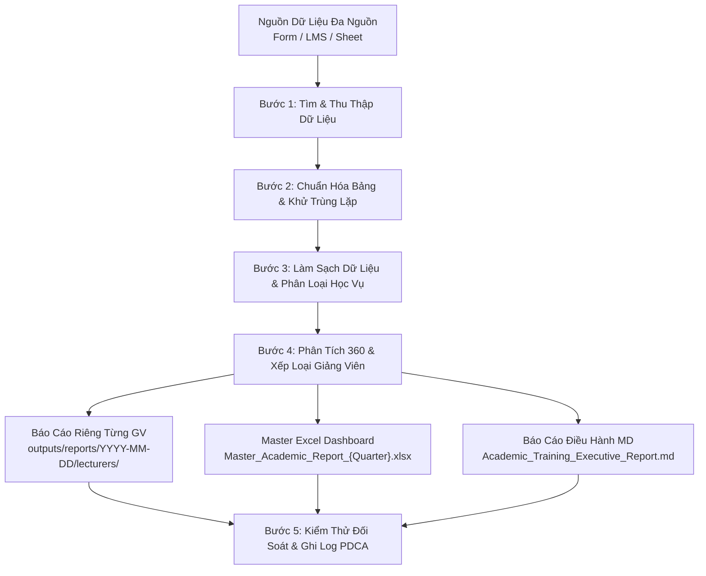

# Academic Training Reporter Skill

Kỹ năng tự động hóa toàn diện quy trình học vụ dành cho **Nhân viên Đào tạo (Academic/Training Executive)** tại các trung tâm giáo dục, học viện đào tạo Công nghệ & AI.

---

## 1. Mục Tiêu & Năng Lực Cốt Lõi (Core Capabilities)

Kỹ năng này giải quyết trọn vẹn 4 thách thức nghiệp vụ lớn:
1. **Tự tìm & Tổng hợp dữ liệu đa nguồn:** Tự động quét và gom dữ liệu điểm số, chuyên cần, khảo sát từ Google Form, LMS Canvas, Google Sheet hoặc file export nội bộ.
2. **Chuẩn hóa cấu trúc bảng (Schema Normalization):** Đưa dữ liệu phân tán về một bảng dữ liệu thống nhất gồm 13 trường chuẩn.
3. **Làm sạch dữ liệu tự động (Automated Data Cleaning):**
   - Khử trùng lặp bản ghi đăng ký nhiều lần.
   - Chuẩn hóa họ tên tiếng Việt (Proper Title Case, khử khoảng trắng thừa).
   - Chuẩn hóa số điện thoại về định dạng 10 chữ số chuẩn quốc gia (xử lý `+84`, `84`, dấu chấm, khoảng trắng).
   - Mapping tên khóa học viết tắt về danh mục đào tạo chính thức.
   - Chuẩn hóa tỷ lệ chuyên cần (0 - 100%) và điểm đồ án (thang điểm 10).
   - Phân loại học vụ tự động: `Tốt nghiệp (Graduated)` / `Thi lại (Re-exam)` / `Rơi rụng (Drop-out)`.
4. **Phân tích 360 độ & Báo cáo cá nhân hóa theo từng giảng viên:**
   - Đánh giá hiệu suất toàn diện: Tỷ lệ tốt nghiệp, Tỷ lệ drop-out, Chuyên cần TB, Điểm đồ án TB, Điểm hài lòng CSAT (1-5 sao), Xếp loại giảng viên.
   - Tách báo cáo Excel riêng cho từng thầy cô bảo mật thông tin nội bộ.
   - Tạo Master Excel Dashboard và Báo cáo điều hành chuyên sâu dạng Markdown cho Ban Giám Đốc.

---

## 2. Dữ Liệu Đầu Vào & Data Schema

### 2.1. Nguồn Dữ Liệu Hỗ Trợ
- File Excel / CSV tổng hợp đặt tại: `sample-data/raw_student_data_multisource.xlsx`
- HOẶC file export từ Google Sheet / LMS hệ thống.

### 2.2. Data Schema Chuẩn Hóa
| Trường dữ liệu | Kiểu dữ liệu | Ý nghĩa nghiệp vụ & Quy tắc chuẩn hóa |
| :--- | :---: | :--- |
| `Ma_HV` | Text | Mã định danh học viên duy nhất (VD: `HV-2026-001`) |
| `Ho_va_Ten` | Text | Họ tên viết hoa chuẩn Title Case (VD: `Nguyễn Văn An`) |
| `So_Dien_Thoai` | Text (`@`) | Số điện thoại 10 chữ số bắt đầu bằng `0` (VD: `0901234567`) |
| `Email` | Text | Email liên hệ học viên |
| `Khoa_Hoc` | Text | Tên khóa học chuẩn sau mapping |
| `Ma_Lop` | Text | Mã lớp học chính thức (VD: `GAI-K12`, `PYA-K08`) |
| `Giang_Vien` | Text | Tên giảng viên phụ trách (kèm danh xưng) |
| `Ty_Le_Chuyen_Can` | Float (%) | Tỷ lệ điểm danh chuyên cần [0.0% - 100.0%] |
| `Diem_Do_An` | Float | Điểm đánh giá đồ án tốt nghiệp [0.0 - 10.0] |
| `Danh_Gia_GV` | Float | Điểm đánh giá mức độ hài lòng về GV CSAT [1.0 - 5.0] |
| `Trang_Thai` | Categorical | `Tốt nghiệp (Graduated)` / `Thi lại (Re-exam)` / `Rơi rụng (Drop-out)` |
| `Nhan_Xet_Hoc_Vien` | Text | Trích xuất feedback thực tế của học viên |
| `Nguon_Du_Lieu` | Text | Nguồn gốc dữ liệu (Google Form / LMS / Google Sheet) |

---

## 3. Quy Trình Vận Hành 5 Bước (Operational Workflow)



### Bước 1: Thu thập & Nhận diện dữ liệu
- Quét các file dữ liệu học viên trong thư mục `sample-data/`.
- Hỗ trợ nạp dữ liệu thô có lỗi thực tế (khoảng trắng thừa, SĐT không đồng nhất, tên khóa học viết tắt).

### Bước 2: Chuẩn hóa bảng & Khử trùng lặp (Deduplication)
- Kiểm tra các bản ghi học viên nộp form nhiều lần.
- Deduplicate dựa trên `Ma_HV` (hoặc bộ ba `Ho_va_Ten`, `So_Dien_Thoai`, `Khoa_Hoc`), giữ lại bản ghi hợp lệ đầu tiên.

### Bước 3: Làm sạch dữ liệu chuyên sâu
- **Họ và Tên:** Loại bỏ khoảng trắng thừa ở đầu/cuối và giữa các từ; chuẩn hóa viết hoa chữ cái đầu từng từ (Proper Title Case tiếng Việt).
- **Số Điện Thoại:** Tách chuỗi số thuần túy; quy đổi các đầu số quốc tế `+84` hoặc `84` thành `0`; bảo đảm đúng 10 chữ số; định dạng text `@` trên Excel để không bị nuốt số 0.
- **Tên Khóa Học:** Map các tên viết tắt (như `GenAI`, `Python Auto`, `Data AI`, `AI Business`) về 4 khóa học chuẩn.
- **Quy tắc phân loại trạng thái học viên:**
  - `Tốt nghiệp (Graduated)`: Chuyên cần ≥ 75.0% VÀ Điểm đồ án ≥ 6.0.
  - `Thi lại / Cần phụ đạo (Re-exam)`: Chuyên cần ≥ 75.0% VÀ Điểm đồ án < 6.0.
  - `Rơi rụng (Drop-out)`: Chuyên cần < 50.0% HOẶC vắng thi / không nộp đồ án.

### Bước 4: Đánh giá hiệu suất giảng viên 360 độ & Xuất bản
- **Khung xếp loại giảng viên:**
  - 🌟 **Xuất sắc:** CSAT ≥ 4.70/5.0 VÀ Tỷ lệ tốt nghiệp ≥ 90.0%.
  - ✅ **Đạt chuẩn:** CSAT ≥ 4.20/5.0 VÀ Tỷ lệ tốt nghiệp ≥ 80.0%.
  - ⚠️ **Cần cải thiện:** CSAT < 4.20/5.0 HOẶC Tỷ lệ rơi rụng > 15.0%.
- **Tạo các file báo cáo cá nhân hóa cho từng Giảng viên:**
  - Lưu tại: `outputs/reports/{YYYY-MM-DD}/lecturers/Report_Lecturer_{SafeName}.xlsx`
  - Gồm: Sheet 1 `Class_Summary` (KPI cards của lớp, xếp loại, điểm mạnh & góp ý cải tiến) và Sheet 2 `Student_List` (Danh sách học viên lớp đó, bảo mật dữ liệu các lớp khác).
- **Tạo Master Academic Excel:**
  - Lưu tại: `outputs/reports/{YYYY-MM-DD}/Master_Academic_Report_{Quarter}.xlsx`
  - Gồm 4 sheet: `Executive_Dashboard` (KPI cards, so sánh GV), `Lecturer_Performance` (360 chi tiết), `Cleaned_Student_Data` (dữ liệu sạch), `Data_Audit_Log` (nhật ký đối soát).
- **Tạo Báo cáo điều hành Markdown:**
  - Lưu tại: `outputs/reports/{YYYY-MM-DD}/Academic_Training_Executive_Report.md`
  - Phân tích chi tiết 4 giảng viên, Risk Matrix cảnh báo rủi ro học vụ và 3 Đề xuất cải tiến PDCA.

### Bước 5: Kiểm định đối soát & Quản trị Workspace
- Chạy kiểm thử tự động xác thực: Tổng số học viên các file con khớp 100% với file Master, 0 bản ghi rò rỉ dữ liệu chéo.
- Ghi nhận nhật ký PDCA vào `docs/pdca-log.md`.
- Cập nhật lịch sử phát triển vào `AGENTS.md`.

---

## 4. Hướng Dẫn Kích Hoạt & Lệnh Chạy (Usage)

### Cách 1: Chạy tự động với cấu hình mặc định (Kỳ hiện tại)
```bash
.venv/bin/python scripts/academic_training_processor.py
```

### Cách 2: Chạy với file dữ liệu tùy chỉnh & ngày báo cáo xác định
```bash
.venv/bin/python scripts/academic_training_processor.py \
  --file sample-data/raw_student_data_multisource.xlsx \
  --report-date 2026-09-12 \
  --quarter 2026-Q3 \
  --output-dir outputs/reports
```

### Cách 3: Chạy script kiểm thử chất lượng tích hợp
```bash
.venv/bin/python scratch/verify_academic_system.py
```

---

## 5. Thư Mục Sản Phẩm Mẫu (Deliverables Structure)

```text
outputs/reports/2026-09-12/
├── Master_Academic_Report_2026-Q3.xlsx
│   ├── Sheet 1: Executive_Dashboard
│   ├── Sheet 2: Lecturer_Performance
│   ├── Sheet 3: Cleaned_Student_Data
│   └── Sheet 4: Data_Audit_Log
├── Academic_Training_Executive_Report.md
└── lecturers/
    ├── Report_Lecturer_Nguyen_Van_An.xlsx
    ├── Report_Lecturer_Tran_Thi_Binh.xlsx
    ├── Report_Lecturer_Le_Hoang_Cuong.xlsx
    └── Report_Lecturer_Pham_Thanh_Dung.xlsx
```
