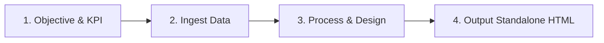

# AI4A: Build Dashboard BI

> **Đóng gói & phát triển bởi MT Đức Thuận**  
> *Dành tặng học viên chương trình Agentic AI with Google Antigravity (AI4A)*  
> *Tiêu chuẩn thiết kế Executive Dashboard & Business Intelligence cao cấp*

Kỹ năng chuyên biệt nhằm tự động hóa việc thiết kế, xây dựng và xuất bản các **Executive BI Dashboards** đẳng cấp quốc tế. Kỹ năng tích hợp trọn bộ 5 tiêu chuẩn thiết kế hiện đại hàng đầu: **Dark Mode**, **Glassmorphism**, **KPI Layout chuẩn mực**, **Phối màu tương phản cao (Glow Accents)** và **Hiệu ứng nhảy số (Count-Up Animation)** tương tác sinh động.

---

## 1. Triết Lý Thiết Kế: "WOW First Impression & Zero Cognitive Friction"

Một Dashboard BI xuất sắc không chỉ hiển thị các con số khô khan, mà phải mang lại:
1. **Ấn tượng thị giác vượt trội (Visual Excellence):** Giao diện Dark Glassmorphic tạo cảm giác công nghệ cao cấp, chuyên nghiệp như các trung tâm điều hành hiện đại (Mission Control Center).
2. **Không gây quá tải nhận thức (Zero Cognitive Friction):** Cấu trúc phân cấp thông tin rõ ràng: nhìn 3 giây đầu biết ngay sức khỏe doanh nghiệp thông qua hàng thẻ KPI chủ lực.
3. **Trực quan & Tương tác sống động (Dynamic & Alive):** Hiệu ứng nhảy số khi tải trang, biểu đồ phát sáng và hover micro-interactions giúp dữ liệu trở nên sống động và khuyến khích người dùng khám phá.

---

## 2. Bộ 5 Tiêu Chuẩn Thiết Kế Dashboard Hiện Đại

### 💎 Tiêu Chuẩn 1: Dark Mode Architecture (Cấu Trúc Nền Tối Sâu)
Không sử dụng màu đen tuyền đơn điệu (`#000000`), mà thiết kế theo cấu trúc phân tầng chiều sâu (Elevation Layers):
- **Base Canvas:** Deep Space Navy hoặc Obsidian (`#080C14`, `#0B0F19`, `#0F172A`).
- **Ambient Glow Mesh:** Sử dụng các dải radial-gradient tản sáng mờ ảo ở các góc nền (Teal, Indigo, Violet) tạo chiều sâu quang học 3D:
  ```css
  background: 
    radial-gradient(circle at 15% 15%, rgba(0, 240, 255, 0.08) 0%, transparent 40%),
    radial-gradient(circle at 85% 20%, rgba(139, 92, 246, 0.08) 0%, transparent 40%),
    radial-gradient(circle at 50% 85%, rgba(16, 185, 129, 0.05) 0%, transparent 50%),
    #080C14;
  ```
- **Phân cấp bề mặt (Surfaces Hierarchy):**
  - *Layer 0 (Canvas):* `#080C14`
  - *Layer 1 (Card/Container Glass):* `rgba(18, 24, 38, 0.65)`
  - *Layer 2 (Card Header / Nested Element):* `rgba(255, 255, 255, 0.03)`
  - *Layer 3 (Active State, Dropdowns, Tooltips):* `rgba(30, 41, 59, 0.95)` với độ mờ cao.

---

### 🪟 Tiêu Chuẩn 2: Glassmorphism Specification (Kính Mờ Tinh Tế)
Hiệu ứng kính mờ chuẩn quang học với 4 thông số bắt buộc:
1. **Backdrop Blur:** `backdrop-filter: blur(16px) saturate(180%);` (kết hợp làm mờ và tăng độ bão hòa màu của nền phía sau).
2. **Translucent Background:** `background: rgba(255, 255, 255, 0.03);` đến `rgba(255, 255, 255, 0.06);`.
3. **Subtle Light Border (Viền vi quang):** `border: 1px solid rgba(255, 255, 255, 0.08);`.
4. **Multi-layer Shadow & Inset Highlight:**
   ```css
   box-shadow: 
     0 20px 40px -15px rgba(0, 0, 0, 0.5),
     inset 0 1px 0 0 rgba(255, 255, 255, 0.1);
   border-radius: 16px;
   ```
5. **Interactive Hover State:**
   - Di chuyển nhẹ: `transform: translateY(-4px);`
   - Viền bừng sáng: `border-color: rgba(0, 240, 255, 0.3);`
   - Hào quang nhẹ: `box-shadow: 0 20px 40px -10px rgba(0, 240, 255, 0.15), inset 0 1px 0 0 rgba(255, 255, 255, 0.2);`
   - Thời gian chuyển động mượt mà: `transition: all 0.3s cubic-bezier(0.16, 1, 0.3, 1);`

---

### 📊 Tiêu Chuẩn 3: KPI Layout Standard (Bố Cục Chỉ Số Chuẩn Mực)
Cụm KPI Cards trên cùng (Top Metric Tier) tuân thủ tỉ lệ bố cục 4 cột (hoặc 3 cột trên màn hình nhỏ):

#### Giải phẫu 1 thẻ KPI Card (Anatomy of an Executive KPI Card):
```
┌─────────────────────────────────────────────────────────────┐
│  [ICON BADGE]  TÊN CHỈ SỐ (UPPERCASE)          [INFO / ⋯ ]  │
│                                                             │
│  1.420.500.000 ₫                                            │
│  ▲ +18.4% vs tháng trước         [Thanh tiến độ đạt 92%]   │
└─────────────────────────────────────────────────────────────┘
```

1. **Header Row:**
   - **Label:** Chữ hoa nhỏ, font-size 11–12px, letter-spacing 0.05em, màu xám bạc dịu mắt (`#94A3B8`).
   - **Icon Badge:** Khung bo tròn `36x36px` hoặc `40x40px`, nền kính màu bán trong suốt ăn khớp với màu chủ đề của chỉ số đó (ví dụ: nền `rgba(0, 240, 255, 0.12)`, icon màu `#00F0FF`).
2. **Hero Number Row (Con số trung tâm):**
   - Kích thước lớn nổi bật (32px - 38px), font-weight 700 - 800.
   - Sử dụng font hiện đại, rõ chữ số: `Plus Jakarta Sans`, `Inter`, `Outfit` hoặc font monospace cho chữ số.
   - Gắn thuộc tính sẵn sàng cho hiệu ứng nhảy số: `class="kpi-counter"` và `data-target="..."`.
3. **Footer Context & Delta Trend Row:**
   - **Trend Delta Badge (Pill tag):** Bo góc `border-radius: 9999px`, đệm `padding: 4px 10px; font-size: 12px; font-weight: 600`.
     - *Tăng trưởng dương:* Xanh ngọc Neon (`#10B981` / `#00FF88`), nền `rgba(16, 185, 129, 0.15)`, ký hiệu `▲ +X.X%`.
     - *Sụt giảm / Cảnh báo:* Hồng/Đỏ Neon (`#F43F5E` / `#FF3366`), nền `rgba(244, 63, 94, 0.15)`, ký hiệu `▼ -X.X%`.
   - **Context Note:** Văn bản so sánh ngữ cảnh ngắn gọn: `"so với kỳ trước"` hoặc thanh tiến độ vi mô (Mini Progress Bar).

---

### 🎨 Tiêu Chuẩn 4: Phối Màu Tương Phản & Neon Accents (Color Contrast System)
Tuyệt đối không sử dụng các màu bệt gốc cơ bản (red, blue, green thô). Sử dụng hệ màu phát quang rực rỡ có kiểm soát theo chuẩn WCAG AA:

| Vai Trò Màu Sắc | Tên Màu & Mã Hex | Mã Nền Kính (Alpha) | Ý Nghĩa Ứng Dụng |
| :--- | :--- | :--- | :--- |
| **Primary Accent** | **Electric Cyan** (`#00F0FF`) | `rgba(0, 240, 255, 0.12)` | Doanh thu, chỉ số công nghệ cốt lõi, đường đồ thị chính |
| **Success / Growth** | **Neon Emerald** (`#10B981` / `#00FF88`) | `rgba(16, 185, 129, 0.15)` | KPI vượt mục tiêu, tăng trưởng dương, tỷ lệ hoàn thành |
| **Warning / Alert** | **Cyber Crimson** (`#F43F5E` / `#FF3366`) | `rgba(244, 63, 94, 0.15)` | Tỷ lệ hủy/rơi rụng, chi phí vượt trần, sụt giảm doanh số |
| **Secondary Analytics** | **Neon Violet** (`#8B5CF6` / `#A855F7`) | `rgba(139, 92, 246, 0.12)` | Phân bổ sản phẩm, phân khúc khách hàng, tỷ lệ chuyển đổi |
| **Pacing / Pending** | **Amber Gold** (`#F59E0B` / `#FFB800`) | `rgba(245, 158, 11, 0.15)` | Đang chờ duyệt, tiến độ đang chạy, chỉ số cần theo dõi |

- **Quy tắc tương phản văn bản:**
  - Tiêu đề & Hero Number: Màu trắng ngọc trai (`#F8FAFC` hoặc `#FFFFFF`) đạt độ tương phản tối đa.
  - Văn bản phụ & Nhãn: Xám bạc (`#94A3B8`).
  - Đường viền mờ: `rgba(255, 255, 255, 0.08)`.

---

### ⚡ Tiêu Chuẩn 5: Hiệu Ứng Nhảy Số (High-Performance Count-Up Engine)
Hiệu ứng nhảy số trực tiếp mang lại cảm giác thời gian thực sống động khi người dùng mở dashboard.

#### Bộ quy chuẩn kỹ thuật cho Count-Up:
1. **Thuật toán Native 60-120fps:** Sử dụng `requestAnimationFrame`, không dùng thư viện ngoài cồng kềnh.
2. **Easing Easing Function (`easeOutExpo`):**
   ```javascript
   function easeOutExpo(t) {
     return t === 1 ? 1 : 1 - Math.pow(2, -10 * t);
   }
   ```
   *Đặc điểm:* Số nhảy rất nhanh ở những mili-giây đầu tiên để tạo phấn khích, sau đó từ tốn hãm phanh chính xác ở con số cuối cùng.
3. **Format Đa Dạng Tự Động:**
   - Tiền tệ Việt Nam: `1.250.000.000 ₫` (dấu chấm phân tách hàng nghìn, ký hiệu `₫` phía sau).
   - Ngoại tệ USD: `$458,200` (dấu phẩy phân tách, ký hiệu `$` phía trước).
   - Phần trăm: `98.4%` (giữ đúng 1-2 chữ số thập phân).
   - Số lượng: `14,280` học viên/khách hàng.
4. **Intersection Observer Tối Ưu:** Chỉ bắt đầu nhảy số khi phần tử thực sự hiển thị trên màn hình người dùng.
5. **Re-triggerable (Tái kích hoạt):** Khi người dùng chuyển đổi bộ lọc thời gian (7 Ngày, 30 Ngày, Quý này), các con số tự động nhảy lại theo số liệu mới mà không cần reload trang.

---

## 3. Cấu Trúc Tổng Thể 1 File BI Dashboard Chuẩn

Mỗi dashboard hoàn chỉnh được xuất bản thành một file **HTML Standalone** tự vận hành, chứa:
```
outputs/dashboards/
└── [Ten_Dashboard]_[YYYYMMDD].html
```

### Bố Cục Giao Diện 4 Tầng (Layout Hierarchy):
1. **Tầng 1 — Glassmorphic Top Header:**
   - Logo & Tên hệ thống báo cáo (Title + Breadcrumb).
   - Live Pulse Badge: Chấm xanh nhấp nháy `"● Real-time Live"`.
   - Time Filter Pills: `[ 24 Giờ ]` `[ 7 Ngày ]` `[ 30 Ngày ]` `[ Quý này ]` `[ Năm nay ]`.
   - Nút Export (In PDF / Xuất CSV / Chụp ảnh Dashboard).
2. **Tầng 2 — Top KPI Tier (4 Cards):**
   - Card 1: Doanh thu chính / Tổng quy mô (Electric Cyan).
   - Card 2: Hiệu suất / Tỷ lệ hoàn thành mục tiêu (Neon Emerald).
   - Card 3: Khách hàng / Học viên / Đối tượng kích hoạt (Neon Violet).
   - Card 4: Tỷ lệ rủi ro / Chi phí / Cảnh báo cần xử lý (Cyber Crimson hoặc Amber).
3. **Tầng 3 — Analytics & Chart Grid (2 Cột):**
   - **Cột trái (60% width):** Biểu đồ diện tích xu hướng (Area Chart with Neon Glowing Gradient) hiển thị diễn biến theo thời gian.
   - **Cột phải (40% width):** Biểu đồ tròn Donut Chart hoặc Radar/Bar Chart hiển thị cơ cấu phân bổ kèm chú thích Glassmorphic.
4. **Tầng 4 — Detail Data Table & Insights Tier:**
   - Bảng phân tích chi tiết với các cột chỉ số, thanh trạng thái (Status pill badge), tìm kiếm nhanh (Live Search) và highlight khi di chuột.
   - Hộp "Executive AI Insights & Action Items" đúc kết 3 phát hiện quan trọng nhất.

---

## 4. Quy Trình Vận Hành OIPO (Workflow Execution)

Khi nhận lệnh thực hiện xây dựng Dashboard BI, tuân thủ đúng 4 bước:



1. **Objective (Mục tiêu):** Xác định mục đích báo cáo (Bán hàng, Học vụ, Vận hành ERP, Tài chính...), đối tượng người xem (CEO, Trưởng phòng, Chuyên viên) và 4 chỉ số KPI quan trọng nhất.
2. **Input (Dữ liệu):** Quét file dữ liệu từ `sample-data/`, `outputs/` hoặc nhận từ prompt người dùng.
3. **Process (Thiết kế & Lập trình):**
   - Tính toán các chỉ số tổng hợp, tỷ lệ tăng trưởng và dữ liệu cho biểu đồ.
   - Áp dụng trọn vẹn bộ Token CSS Glassmorphism & Dark Mode.
   - Nhúng thư viện Chart.js qua CDN an toàn và tích hợp Native Count-Up Engine.
4. **Output (Xuất bản):** Xuất file HTML hoàn chỉnh vào `outputs/dashboards/<ten_dashboard>.html`, mở kiểm thử trên trình duyệt và ghi nhật ký PDCA.

---

## 5. Mẫu Code Chuẩn (Ready-to-use Code Snippets)

### 5.1. Engine Nhảy Số Native (Zero Dependency)
```javascript
function animateCountUp(element, targetValue, duration = 1800, prefix = '', suffix = '', decimals = 0) {
  const start = 0;
  const startTime = performance.now();

  function easeOutExpo(t) {
    return t === 1 ? 1 : 1 - Math.pow(2, -10 * t);
  }

  function formatNumber(num) {
    if (decimals > 0) {
      return num.toLocaleString('vi-VN', { minimumFractionDigits: decimals, maximumFractionDigits: decimals });
    }
    return Math.round(num).toLocaleString('vi-VN');
  }

  function update(currentTime) {
    const elapsed = currentTime - startTime;
    const progress = Math.min(elapsed / duration, 1);
    const easedProgress = easeOutExpo(progress);
    const currentValue = start + (targetValue - start) * easedProgress;

    element.textContent = `${prefix}${formatNumber(currentValue)}${suffix}`;

    if (progress < 1) {
      requestAnimationFrame(update);
    } else {
      element.textContent = `${prefix}${formatNumber(targetValue)}${suffix}`;
    }
  }

  requestAnimationFrame(update);
}
```

### 5.2. Glassmorphic Card CSS Chuẩn
```css
.glass-card {
  background: rgba(18, 24, 38, 0.65);
  backdrop-filter: blur(16px) saturate(180%);
  -webkit-backdrop-filter: blur(16px) saturate(180%);
  border: 1px solid rgba(255, 255, 255, 0.08);
  border-radius: 16px;
  padding: 24px;
  box-shadow: 0 20px 40px -15px rgba(0, 0, 0, 0.5), inset 0 1px 0 0 rgba(255, 255, 255, 0.1);
  transition: all 0.3s cubic-bezier(0.16, 1, 0.3, 1);
  position: relative;
  overflow: hidden;
}

.glass-card:hover {
  transform: translateY(-4px);
  border-color: rgba(0, 240, 255, 0.35);
  box-shadow: 0 24px 48px -10px rgba(0, 240, 255, 0.15), inset 0 1px 0 0 rgba(255, 255, 255, 0.2);
}
```

---

## 6. Template & Tài Nguyên Đi Kèm Trong Skill

Skill cung cấp sẵn bộ khung mẫu hoàn chỉnh nằm ngay trong thư mục:
- [bi_dashboard_template.html](file:///.agents/skills/ai4a-build-dashboard-bi/templates/bi_dashboard_template.html): Bản mẫu Dashboard BI chạy độc lập, đầy đủ hiệu ứng và biểu đồ.
- [glassmorphism_tokens.css](file:///.agents/skills/ai4a-build-dashboard-bi/templates/glassmorphism_tokens.css): Hệ thống Design Tokens CSS biến số dùng chung.
- [count_up.js](file:///.agents/skills/ai4a-build-dashboard-bi/templates/count_up.js): Thư viện nhảy số độc lập sẵn sàng nhúng.

---

## 7. Ranh Giới & Guardrails

- Không dùng thư viện React/Vue nặng nếu bài toán chỉ yêu cầu hiển thị báo cáo: Luôn ưu tiên xuất bản **Single HTML File** có thể mở xem trực tiếp trên mọi trình duyệt mà không cần cài đặt môi trường phức tạp.
- Đảm bảo độ tương phản chữ và nền: Luôn kiểm tra màu chữ chính đủ sáng (trên `#E2E8F0`), không dùng màu tối trên nền kính.
- Không để hiệu ứng nhảy số chạy liên tục không điểm dừng gây giật màn hình: Luôn khóa ngưỡng kết thúc sau tối đa 2.0 giây.
