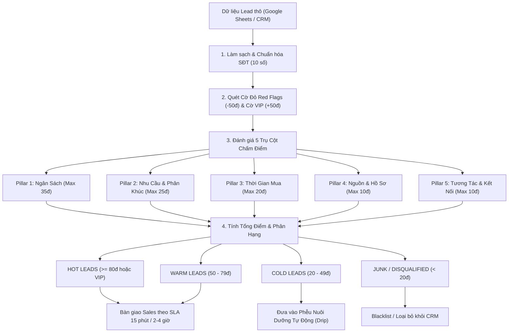

# Lead Scoring Skill — Chấm Điểm & Phân Loại Khách Hàng Tiềm Năng Bất Động Sản

Bộ kỹ năng chuẩn hóa quy trình phân tích, định lượng chất lượng khách hàng tiềm năng (Leads) trong ngành Bất Động Sản bằng AI, tích hợp ma trận 5 tiêu chí cốt lõi, cơ chế nhận diện khách VIP (+50 điểm) và lọc bỏ rác (-50 điểm), thiết lập SLA tiếp cận theo thời gian vàng và giao thức bàn giao chuyên nghiệp cho đội ngũ Kinh doanh (Sales).

---

## 1. Định Nghĩa Lead Scoring & Tại Sao Quan Trọng Trong Bất Động Sản

### 1.1. Lead Scoring là gì?
**Lead Scoring (Chấm điểm khách hàng tiềm năng)** là phương pháp định lượng giá trị và mức độ sẵn sàng giao dịch của một khách hàng bằng cách gán điểm số cụ thể dựa trên:
1. **Thông tin nhân khẩu & hồ sơ tài chính** (Khả năng chi trả, thẩm quyền ra quyết định).
2. **Nhu cầu & tính khả thi** (Phân khúc BĐS, mục đích mua ở hay đầu tư, tính thực tế về giá).
3. **Mức độ tương tác & tính cấp thiết** (Thời điểm mua, hành vi phản hồi, mong muốn xem dự án thực tế).

### 1.2. Tại sao Lead Scoring có ý nghĩa sống còn trong Bất Động Sản?
Ngành Bất động sản có những đặc thù rất khác biệt so với bán lẻ (E-commerce hay FMCG):
- **Giá trị giao dịch cực lớn:** Mỗi sản phẩm có giá trị từ vài tỷ đến hàng chục/hàng trăm tỷ đồng.
- **Chu kỳ bán hàng dài (Long Sales Cycle):** Từ lúc khách phát sinh nhu cầu đến lúc đặt cọc có thể mất từ vài tuần đến 6 - 12 tháng.
- **Chi phí thu hút Lead (CPL - Cost Per Lead) rất đắt đỏ:** Doanh nghiệp phải chi trả hàng trăm nghìn đến hàng triệu đồng cho mỗi lead từ Google Ads, Facebook Ads hay sự kiện mở bán.
- **Nguồn lực Sales có hạn:** Một chuyên viên tư vấn BĐS chỉ có thể chăm sóc sâu tối đa 10 - 15 khách hàng/ngày để đảm bảo chất lượng tư vấn, khảo sát thực địa và đàm phán hợp đồng.
- **Tránh kiệt sức & lãng phí thời gian của Sales:** Nếu không chấm điểm, Sales sẽ mất 70% thời gian gọi điện cho các số nhầm, data rác, người hỏi giá cho vui hoặc khách hàng có yêu cầu phi thực tế (nhà Quận 1 giá 1 tỷ).
- **Tối ưu hóa tỷ lệ chuyển đổi (Conversion Rate):** Phân loại chính xác giúp Sales dồn 80% năng lượng vào 20% khách hàng tiềm năng nhất (Nguyên lý Pareto), từ đó gia tăng doanh số và rút ngắn chu kỳ chốt deal.

---

## 2. Quy Trình Chấm Điểm 5 Tiêu Chí (5 Scoring Pillars)

Hệ thống tính điểm dựa trên khung mở rộng của mô hình BANT kết hợp Hành vi tương tác và Quy chuẩn chấm điểm BĐS:



### Chi tiết 5 Tiêu chí:

#### Tiêu chí 1: Ngân Sách (Budget — Tối đa 35 điểm)
- **Tài chính siêu cấp / Ngân sách mở (35 điểm):** Đề cập số tiền cụ thể từ 20 tỷ trở lên, hoặc các cụm từ *"tài chính mạnh"*, *"tài chính cực mạnh"*, *"không thành vấn đề"*, *"thanh toán thẳng"*, *"gom sỉ"*.
- **Tầm trung - khá (25 điểm):** 4 - 10 tỷ (căn hộ cao cấp, nhà phố) hoặc ngân sách thuê mặt bằng kinh doanh > 30 - 50 triệu/tháng.
- **Tầm trung bình - vùng ven (15 - 20 điểm):** 2 - 3 tỷ (đất nền vùng ven Long An, Đồng Nai, căn hộ ngoại thành).
- **Yêu cầu phi thực tế (-50 điểm):** Đòi hỏi giá thấp vô lý so với thị trường (VD: đòi mua nhà Quận 1 giá 1-2 tỷ, thuê nguyên căn trung tâm giá 2 triệu).

#### Tiêu chí 2: Mức Độ Quan Tâm & Phân Khúc (Need & Interest — Tối đa 25 điểm)
- **Loại hình cao cấp & Vị trí đắc địa (25 điểm):**
  - Tìm kiếm: *"Penthouse"*, *"Biệt thự đơn lập"*, *"Shophouse mặt đường lớn"*, *"Quỹ đất công nghiệp"*, *"Sàn văn phòng diện tích lớn (>2000m2)"*.
  - Vị trí: *"Quận 1"*, *"Ven sông"*, *"Vinhomes Ocean Park"*, *"Phú Mỹ Hưng"*.
- **Nhu cầu ở thực & Đầu tư rõ ràng (18 - 20 điểm):** Căn hộ 2PN cho gia đình trẻ, thuê mặt bằng kinh doanh spa, đất nền đầu tư sổ hồng riêng.
- **Nhu cầu mơ hồ (5 - 10 điểm):** Chưa xác định rõ loại hình, đang tìm hiểu chung chung.
- **Không có nhu cầu / Hỏi cho vui (-50 điểm):** Khách báo nhầm số, dữ liệu cũ, nhầm ngành, hỏi giá cho vui.

#### Tiêu chí 3: Thời Gian Mua & Tính Cấp Thiết (Timeline & Urgency — Tối đa 20 điểm)
- **Cấp thiết / Chốt ngay (20 điểm):** *"Muốn đi xem nhà mẫu cuối tuần này"*, *"Cần ký hợp đồng dài hạn ngay"*, *"Thanh toán thẳng"*, *"Muốn gặp trực tiếp Giám đốc dự án / Chủ đầu tư để đàm phán"*.
- **Trung hạn (10 - 15 điểm):** Cần mua trong 1 - 3 tháng, đang chờ giải ngân hoặc cân nhắc gói vay ngân hàng.
- **Dài hạn (5 điểm):** Đầu tư dài hạn (> 6 tháng - 1 năm).
- **Trì hoãn / Không có kế hoạch (-20 điểm):** *"Chưa có ý định mua trong năm nay"*, *"hỏi cho biết"*.

#### Tiêu chí 4: Nguồn Khách & Hồ Sơ Thẩm Quyền (Source & Authority — Tối đa 10 điểm)
- **Chủ thể VIP / Quyền quyết định cao (10 điểm):** *"Chủ doanh nghiệp"*, *"Nhà đầu tư chuyên nghiệp"*, *"Khách hàng VIP đã từng mua nhiều dự án của tập đoàn"*.
- **Khách hàng cá nhân rõ ràng (8 điểm):** Gia đình trẻ có việc làm ổn định, chủ hộ kinh doanh spa.
- **Khách hàng vãng lai (5 điểm):** Nguồn data lạnh, chưa xác minh được danh tính.
- **Spam / Đối tượng dịch vụ khác (-50 điểm):** Gọi đến để quảng cáo ngược bảo hiểm, mời chào vay vốn cá nhân.

#### Tiêu chí 5: Tương Tác & Khả Năng Tiếp Cận (Engagement & Reachability — Tối đa 10 điểm)
- **Tương tác tích cực & Cởi mở (10 điểm):** Sẵn sàng chia sẻ nhu cầu, đòi hỏi minh bạch (*"Pháp lý chuẩn 100%"*, *"Sổ hồng riêng"*), chủ động đề xuất lịch gặp.
- **Tương tác cơ bản (5 điểm):** Bắt máy trao đổi ngắn gọn.
- **Rào cản liên lạc / Bất hợp tác (-50 điểm):** Số thuê bao, gọi nhiều lần không nghe máy, nhắn tin Zalo không phản hồi, thái độ bất hợp tác khi tư vấn.

---

## 3. Cách Phân Loại HOT / WARM / COLD / JUNK

| Cấp Bậc (Tier) | Ngưỡng Điểm | Tiêu Chuẩn Nhận Diện | Hành Động Chiến Lược & SLA | Người Phụ Trách |
|:---|:---:|:---|:---|:---|
| **🔥 HOT (VIP)** | **>= 80 điểm**<br>*(hoặc đạt >= 2 cờ VIP)* | - Ngân sách >= 20 tỷ hoặc không thành vấn đề<br>- BĐS cao cấp: Penthouse, Biệt thự ven sông, Shophouse sỉ, Sàn VP lớn<br>- Chủ DN / NĐT chuyên nghiệp / Cần chốt gấp | **SLA: Bốc máy gọi ngay trong vòng 15 phút**<br>- Gặp trực tiếp hoặc xếp xe đưa đón xem dự án cuối tuần<br>- Chuẩn bị hồ sơ pháp lý 100% | Giám đốc kinh doanh / Trưởng bộ phận VIP / Senior Sales |
| **⚡ WARM** | **50 - 79 điểm** | - Nhu cầu ở thực hoặc đầu tư tầm trung (2 - 10 tỷ)<br>- Chung cư gia đình trẻ, đất nền vùng ven có sổ, thuê mặt bằng spa<br>- Cần tư vấn thêm đòn bẩy tài chính hoặc pháp lý | **SLA: Phân bổ gọi trong 2 - 4 giờ làm việc**<br>- Gửi thông tin layout dự án, chính sách chiết khấu và bảng tính lãi suất qua Zalo | Chuyên viên tư vấn chính thức (Account Executive) |
| **❄️ COLD** | **20 - 49 điểm** | - Khách hỏi tham khảo giá, chưa có ý định mua trong năm<br>- Nhu cầu còn mơ hồ, chưa chuẩn bị tài chính<br>- Gọi khó bắt máy nhưng chưa chặn số | **SLA: Đưa vào hệ thống tự động trong 24 giờ**<br>- Gửi bản tin thị trường định kỳ hàng tuần qua Zalo OA/Email<br>- Không gọi điện ép chốt | Hệ thống Marketing Automation (Drip Campaign) |
| **🚫 JUNK / SPAM** | **< 20 điểm**<br>*(hoặc dính Red Flag)* | - Yêu cầu phi thực tế (nhà Q1 giá 1 tỷ, thuê TT 2 triệu)<br>- Nhầm số, dữ liệu cũ, nhầm ngành<br>- Thuê bao nhiều lần, thái độ bất hợp tác<br>- Spam bán bảo hiểm, cho vay | **SLA: Loại bỏ ngay lập tức**<br>- Gắn nhãn Blacklist / Disqualified<br>- Thu hồi khỏi danh sách gọi để tránh lãng phí thời gian Sales | Hệ thống CRM (Auto-Purge) |

---

## 4. Lưu Ý Khi AI Chấm Điểm Tự Động (Giới Hạn & Rủi Ro)

Dù AI xử lý ngôn ngữ tự nhiên (NLP) rất nhanh, nhưng việc áp dụng trong Bất Động Sản đòi hỏi phải kiểm soát các rủi ro cốt lõi sau:

### 4.1. Bẫy Ảo Giác Từ Khóa (Keyword Illusion)
- *Hiện tượng:* Khách hàng dùng các từ ngữ hoa mỹ như *"cần căn hộ sang trọng, view triệu đô"* nhưng ngân sách ghi nhận chỉ có 1 tỷ, hoặc nói *"tài chính mạnh"* nhưng định nghĩa "mạnh" của khách chỉ là 2 tỷ đồng.
- *Giải pháp:* AI không chỉ match từ khóa đơn lẻ mà phải phân tích **tương quan logic** giữa Ngân sách và Phân khúc đề xuất. Nếu xuất hiện mâu thuẫn (VD: Nhà Q1 + 1 tỷ), hệ thống phải kích hoạt cờ *Yêu cầu phi thực tế* ngay.

### 4.2. Dữ liệu đầu vào không hoàn hảo (Dirty & Informal Data)
- *Hiện tượng:* Nhân viên ghi nhận dữ liệu thường viết tắt, sai chính tả hoặc dùng tiếng lóng (*"biet thu", "sh", "nham so", "ko nghe may", "q1", "pmh"*).
- *Giải pháp:* Cần pipeline tiền xử lý (pre-processing) chuẩn hóa text, loại bỏ dấu thanh khi cần và dùng regex mềm dẻo.

### 4.3. Bỏ sót khách tiềm năng kín tiếng (False Negatives)
- *Hiện tượng:* Nhiều đại gia hoặc nhà đầu tư lớn rất kín tiếng, khi để lại thông tin chỉ nhắn cộc lốc: *"inbox giá"* hoặc không cung cấp ngân sách vì ngại bị làm phiền.
- *Giải pháp:* Thiết lập cơ chế **Audit ngẫu nhiên (Human-in-the-loop)** 10 - 15% lead ở nhóm COLD trước khi loại bỏ hoàn toàn.

### 4.4. Biến động giá thị trường theo thời gian
- *Hiện tượng:* Ngưỡng giá 20 tỷ tại thời điểm sốt đất khác với lúc thị trường trầm lắng; giá tại TP.HCM khác với tỉnh lẻ.
- *Giải pháp:* Bộ tiêu chí phải có cấu hình tham số linh hoạt (`scoring_rubric.md`), có thể điều chỉnh theo từng quý hoặc từng phân khúc dự án.

---

## 5. Giao Thức Bàn Giao Kết Quả Cho Sales (Sales Handover Protocol)

Để việc chấm điểm mang lại doanh thu thực tế, quy trình chuyển giao từ AI sang con người phải tuân thủ nghiêm ngặt 3 nguyên tắc:

### 5.1. Quy Tắc 15 Phút Vàng (Golden 15-Minute Window)
- **Tâm lý học khách hàng BĐS:** Khách hàng quan tâm dự án thường đăng ký tư vấn tại nhiều trang web cùng lúc. Sales nào liên hệ đầu tiên khi nhu cầu của khách đang "nóng" nhất sẽ có tỷ lệ chốt lịch hẹn cao gấp 4 lần so với sau 1 giờ.
- **Cơ chế Re-assign:** Nếu lead HOT được giao cho 1 Sales nhưng sau 30 phút chưa có nhật ký cuộc gọi (call log), hệ thống tự động thu hồi và phân bổ cho Sales khác.

### 5.2. Gói Thông Tin Bàn Giao (Lead Handover Package)
Khi nhận 1 lead HOT/WARM, Sales không nhận một dòng text cụ thể mà nhận trọn bộ hồ sơ gồm 4 phần:
1. **Thông tin định danh:** Họ tên, SĐT đã chuẩn hóa 10 số, Phân loại Tier (HOT/WARM).
2. **Bảng phân rã điểm số (Score Breakdown):** Điểm chi tiết của từng tiêu chí (Ngân sách, Nhu cầu, Tính cấp thiết, Hồ sơ, Tương tác).
3. **Phân khúc giỏ hàng đề xuất (Target Inventory):** Dự án/Căn hộ khớp nhất trong kho hàng.
4. **Kịch bản tiếp cận đề xuất (Tailored Pitch Angle):** Lời thoại mở đầu phù hợp tâm lý (VD: Khách Penthouse nói về sự riêng tư và đẳng cấp; khách gia đình trẻ nói về tiện ích trường học và bài toán trả góp).

### 5.3. Vòng Phản Hồi Đóng (Closed-Loop Feedback)
- Sales bắt buộc phải cập nhật kết quả cuộc gọi đầu tiên trong vòng 2 giờ trên CRM:
  - `Đã chốt lịch hẹn xem thực tế`
  - `Đang gửi tài liệu qua Zalo`
  - `Báo sai nhu cầu / Khách đổi ý`
  - `Thuê bao không liên lạc được`
- Dữ liệu này được đưa ngược lại hệ thống để AI tự động hiệu chỉnh trọng số chấm điểm (Reinforcement Learning from Human Feedback).

---

## 6. Hướng Dẫn Vận Hành Script Tự Động Hóa

### 6.1. Cấu trúc tệp tin của Skill
```
.agents/skills/lead-scoring/
├── SKILL.md                          # Tài liệu hướng dẫn & quy chuẩn vận hành
├── scripts/
│   └── score_leads.py               # Engine Python chấm điểm & xuất báo cáo Excel/MD
└── references/
    └── scoring_rubric.md            # Bảng tra cứu trọng số và từ khóa nhận diện
```

### 6.2. Lệnh thực thi từ dòng lệnh (Terminal)
```bash
# 1. Chạy với Google Sheet URL trực tiếp
.venv/bin/python scripts/score_leads.py "https://docs.google.com/spreadsheets/d/17rbCAc-gDhSMesf7ILLCHofbg-89i-ecc9mOQPgH6Dg/export?format=csv"

# 2. Hoặc chạy với file dữ liệu nội bộ
.venv/bin/python scripts/score_leads.py "sample-data/real_estate_leads_raw.csv" "outputs/reports/BDS_Lead_Scoring_Report.xlsx" "outputs/reports/BDS_Lead_Scoring_Executive_Summary.md"
```

### 6.3. File kết quả bàn giao
- **File Excel chuyên nghiệp:** `outputs/reports/BDS_Lead_Scoring_Report.xlsx` gồm 3 sheet:
  - `Executive Summary`: KPI cards và bảng tổng hợp tỷ lệ phân bổ.
  - `All Leads Scored`: Toàn bộ bảng điểm 5 tiêu chí và cờ nhận diện.
  - `Sales Handover`: Danh sách khách hàng HOT & WARM sẵn sàng gọi điện kèm kịch bản tiếp cận.
- **File Báo cáo Điều hành:** `outputs/reports/BDS_Lead_Scoring_Executive_Summary.md` tóm tắt toàn diện cho Ban Giám Đốc.
