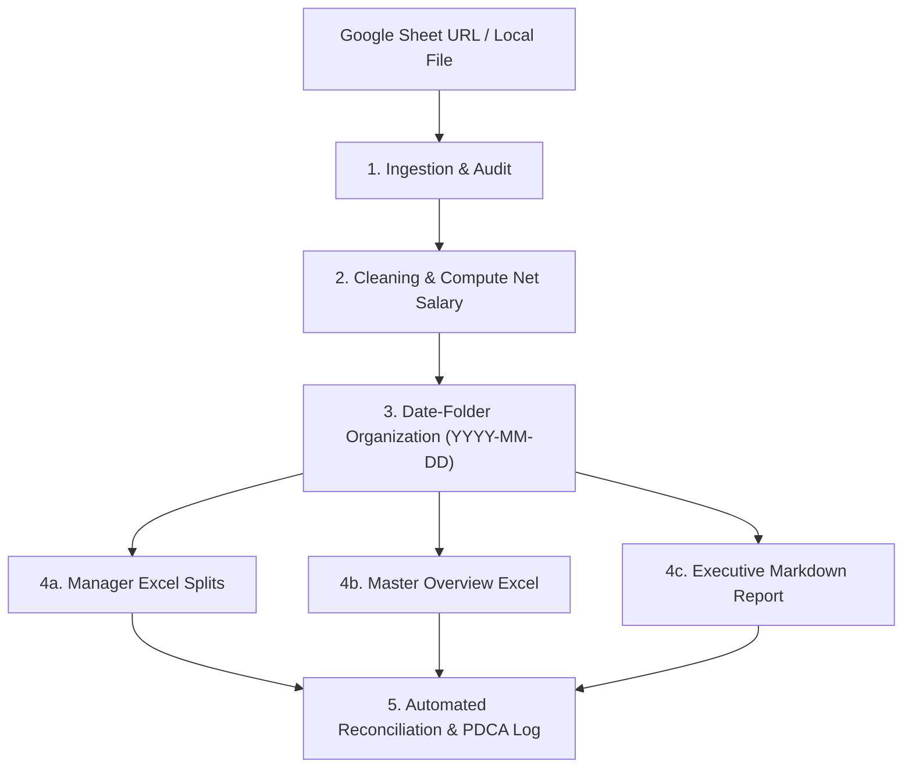

# Operations ERP Monthly Reporter Skill

Kỹ năng tự động hóa toàn diện quy trình đối soát, làm sạch dữ liệu, chia tách báo cáo cho các Quản lý và lập báo cáo điều hành từ dữ liệu ERP hàng tháng cho Operations Analyst.

## 1. Mục Tiêu & Phạm Vi (Scope)
- Thay thế hoàn toàn thao tác thủ công (mở Google Sheet, lọc filter, copy-paste từng manager, tính tổng bằng tay).
- Giảm thời gian xử lý từ nhiều giờ xuống dưới 5 giây.
- Đảm bảo 100% độ chính xác trong tính toán số liệu và tính toàn vẹn dữ liệu.
- Lưu trữ ngăn nắp có hệ thống theo thư mục ngày báo cáo `outputs/reports/YYYY-MM-DD/`.

## 2. Dữ Liệu Đầu Vào (Inputs)
- **Nguồn dữ liệu:**
  - Google Sheet URL (dạng `https://docs.google.com/spreadsheets/d/.../edit?gid=...`)
  - HOẶC file CSV / Excel nội bộ đặt trong `sample-data/`
- **Schema dữ liệu chuẩn (8 trường cốt lõi):**
  - `Employee_ID`: Mã nhân viên (duy nhất, không trùng lặp)
  - `Employee_Name`: Họ và tên nhân viên
  - `Manager`: Tên quản lý trực tiếp (Manager A, B, C, D...)
  - `Department`: Phòng ban (Operations, Sales, Finance, HR...)
  - `Base_Salary`: Lương cơ bản cố định (VNĐ)
  - `Bonus`: Tiền thưởng hiệu suất (VNĐ)
  - `Penalty`: Tiền phạt chế tài (VNĐ)
  - `Month`: Kỳ báo cáo (YYYY-MM)

## 3. Quy Trình 5 Bước Vận Hành Chuẩn



### Bước 1: Thu thập & Kiểm định tính toàn vẹn (Data Audit)
- Tự động bóc tách Sheet ID và GID để lấy link export CSV:
  `https://docs.google.com/spreadsheets/d/{ID}/export?format=csv&gid={GID}`
- Tải file an toàn qua tiện ích hệ thống (tránh lỗi SSL certificate).
- Kiểm tra các lỗi thường gặp:
  - Trùng lặp `Employee_ID` (nếu có phải cảnh báo & deduplicate).
  - Thiếu trường dữ liệu (null values).
  - Kiểu dữ liệu không đúng định dạng số.

### Bước 2: Làm sạch & Tính toán chỉ số nghiệp vụ
- **Thực nhận:** `Net_Salary = Base_Salary + Bonus - Penalty`
- **Tỷ lệ thưởng:** `Bonus_Rate = Bonus / Base_Salary`
- **Tỷ lệ phạt:** `Penalty_Rate = Penalty / Base_Salary`

### Bước 3: Cấu trúc thư mục ngày báo cáo (Folder Organization)
Mỗi kỳ báo cáo phải được nhóm vào một thư mục riêng biệt theo định dạng ngày chạy hoặc kỳ báo cáo:
```text
outputs/reports/{YYYY-MM-DD}/
├── Company_Overview_{Month}.xlsx
├── Executive_Operations_Report_{Month}.md
└── managers/
    ├── Report_Manager_A_{Month}.xlsx
    ├── Report_Manager_B_{Month}.xlsx
    └── ...
```

### Bước 4: Xuất bản các deliverables chuyên nghiệp
1. **File Excel riêng cho từng Manager (`Report_{Manager}_{Month}.xlsx`):**
   - Header banner thương hiệu màu Dark Navy (`#1F4E79`), chữ trắng in đậm.
   - Sắp xếp theo Phòng ban rồi đến Mã nhân viên.
   - Định dạng tiền tệ VNĐ: `#,##0 ₫` và tỷ lệ: `0.0%`.
   - Kẻ viền ô, xen kẽ màu dòng (zebra striping `#F9FAFC`).
   - Dòng **TỔNG CỘNG** ở cuối bảng với công thức Excel động: `=SUM(...)`.
2. **Master Overview Excel (`Company_Overview_{Month}.xlsx`):**
   - Trang `Executive_Dashboard`: KPI summary cards (Tổng nhân sự, Quỹ lương thực nhận, Lương cơ bản, Tổng thưởng, Tổng phạt, Thu nhập TB); Bảng Pivot theo Phòng ban; Bảng Pivot theo Manager.
   - Trang `Master_Data_Cleaned`: Dữ liệu 100% nhân viên đã làm sạch và kèm công thức Thực nhận.
3. **Báo cáo điều hành cấp cao (`Executive_Operations_Report_{Month}.md`):**
   - Tóm tắt điều hành (Executive Summary).
   - Biểu đồ phân bổ tỷ trọng bằng sơ đồ Mermaid.
   - Bảng đối soát đa chiều (Phòng ban, Quản lý).
   - Phân tích ngoại lệ (Top 3 nhân sự thưởng cao nhất, Top 3 bị phạt nhiều nhất).
   - 3 đề xuất hành động chiến lược cho kỳ tới.

### Bước 5: Kiểm định đối soát & Quản trị Workspace
- Chạy script đối soát tự động: Tổng số nhân sự của các file con phải đúng bằng tổng số nhân sự file master.
- Ghi nhận nhật ký vào `docs/pdca-log.md` (Plan → Do → Check → Act).
- Cập nhật dòng lịch sử tương ứng tại `AGENTS.md`.

## 4. Lệnh Thực Thi Chuẩn

```bash
# Cách 1: Tải trực tiếp từ link Google Sheet của tháng mới
./.venv/bin/python scripts/monthly_erp_processor.py --sheet-url "<URL_GOOGLE_SHEET>"

# Cách 2: Tải với file đã lưu trong máy
./.venv/bin/python scripts/monthly_erp_processor.py --file sample-data/raw_erp_data.csv

# Cách 3: Chỉ định ngày tạo thư mục báo cáo tùy chỉnh
./.venv/bin/python scripts/monthly_erp_processor.py --sheet-url "<URL_GOOGLE_SHEET>" --report-date 2026-09-09
```
