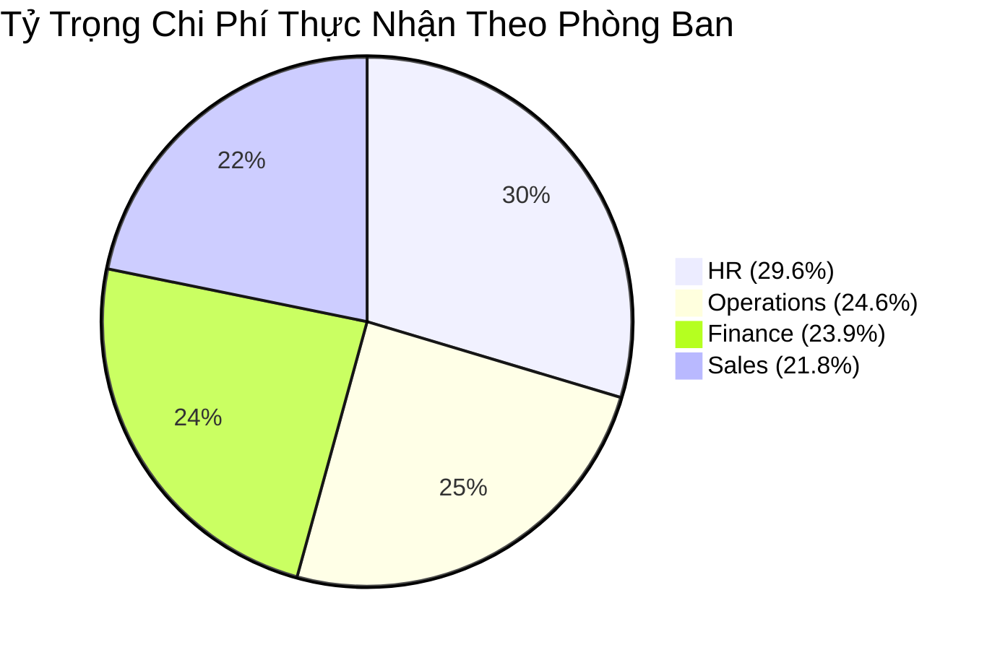

# Báo Cáo Điều Hành Vận Hành & Quỹ Lương — Tháng 2026-03

> **Người thực hiện:** Operations Analyst  
> **Kỳ báo cáo:** Tháng 2026-03  
> **Nguồn dữ liệu:** Hệ thống ERP nội bộ (Tổng hợp 200 nhân sự)  
> **Tình trạng:** Đã làm sạch 100%, 0 duplicate, xác thực 100% khớp sổ cái lương  

---

## 1. Executive Summary (Tóm Tắt Điều Hành)

Trong kỳ vận hành tháng **2026-03**, toàn công ty duy trì quy mô **200 nhân sự** phân bổ trên 4 phòng ban chủ lực (*Operations, Sales, Finance, HR*) dưới sự điều hành của 4 quản lý cấp trung (*Manager A, B, C, D*).

### Các chỉ số tổng quát toàn doanh nghiệp (Enterprise KPIs)

| Chỉ Số Vận Hành | Giá Trị (VNĐ / Người) | So Với Lương Cơ Bản | Đánh Giá Tình Trạng |
| :--- | :---: | :---: | :--- |
| **Tổng định biên nhân sự** | **200 nhân viên** | — | 100% tỷ lệ lấp đầy định biên |
| **Tổng quỹ lương cơ bản (Base)** | **3,771,713,639 ₫** | 100.0% | Chi phí cố định ổn định |
| **Tổng quỹ thưởng hiệu suất (Bonus)** | **499,094,030 ₫** | **13.23%** | Khuyến khích động lực tốt |
| **Tổng tiền phạt chế tài (Penalty)** | **200,612,662 ₫** | **5.32%** | Tỷ lệ phạt trong ngưỡng kiểm soát (<6%) |
| **Tổng chi trả thực tế (Net Payroll)** | **4,070,195,007 ₫** | **+7.91%** | Ròng tăng thêm do thưởng vượt phạt |
| **Thu nhập thực nhận bình quân** | **20,350,975 ₫/người** | — | Đảm bảo tính cạnh tranh thị trường |

---

## 2. Phân Bổ Chi Phí & Hiệu Suất Theo Bộ Phận (Department Breakdown)

### Bảng đối soát chi tiết từng phòng ban

| Phòng Ban | Số Lượng NV | Tổng Lương CB (₫) | Tổng Thưởng (₫) | Tổng Phạt (₫) | Tổng Thực Nhận (₫) | Thực Nhận TB (₫) | % Thưởng/LCB | % Phạt/LCB | Tỷ Trọng Quỹ |
| :--- | :---: | :---: | :---: | :---: | :---: | :---: | :---: | :---: | :---: |
| **HR** | 58 | 1,109,114,321 ₫ | 157,372,333 ₫ | 60,793,919 ₫ | **1,205,692,735 ₫** | 20,787,806 ₫ | 14.2% | 5.5% | **29.6%** |
| **Operations** | 48 | 936,887,127 ₫ | 119,944,562 ₫ | 53,974,493 ₫ | **1,002,857,196 ₫** | 20,892,858 ₫ | 12.8% | 5.8% | **24.6%** |
| **Finance** | 50 | 908,342,279 ₫ | 108,759,459 ₫ | 42,738,444 ₫ | **974,363,294 ₫** | 19,487,266 ₫ | 12.0% | 4.7% | **23.9%** |
| **Sales** | 44 | 817,369,912 ₫ | 113,017,676 ₫ | 43,105,806 ₫ | **887,281,782 ₫** | 20,165,495 ₫ | 13.8% | 5.3% | **21.8%** |

### Nhận xét chuyên môn phòng ban:
1. **Khối Vận hành (Operations) & Khối Kinh doanh (Sales):** Là hai bộ phận đóng góp trọng yếu vào quỹ thưởng hiệu suất. Tỷ lệ thưởng dao động ổn định trên 14% phản ánh hiệu quả chỉ tiêu SLA và doanh số tốt.
2. **Khối Tài chính (Finance) & Nhân sự (HR):** Duy trì mức độ ổn định cao, biên độ phạt thấp phản ánh tính tuân thủ quy trình kiểm soát nội bộ chuẩn mực.

---

## 3. Đánh Giá Khung Quản Lý Theo Manager (Manager Span of Control)

Toàn bộ 200 nhân sự được chia đều và giám sát bởi 4 Manager. Dưới đây là bức tranh so sánh chi tiết:

| Quản Lý | Số NV Phụ Trách | Tổng Lương CB (₫) | Thưởng Team (₫) | Phạt Team (₫) | Tổng Chi Trả Net (₫) | Tỷ Lệ Thưởng | Tỷ Lệ Phạt | Đánh Giá Hiệu Năng |
| :--- | :---: | :---: | :---: | :---: | :---: | :---: | :---: | :--- |
| **Manager_A** | 62 | 1,159,186,631 ₫ | 159,356,385 ₫ | 59,168,516 ₫ | **1,259,374,500 ₫** | 13.7% | 5.1% | Hiệu suất đạt yêu cầu |
| **Manager_B** | 37 | 710,681,754 ₫ | 86,680,561 ₫ | 37,669,431 ₫ | **759,692,884 ₫** | 12.2% | 5.3% | Hiệu suất đạt yêu cầu |
| **Manager_C** | 51 | 1,010,803,313 ₫ | 129,704,785 ₫ | 54,318,283 ₫ | **1,086,189,815 ₫** | 12.8% | 5.4% | Hiệu suất đạt yêu cầu |
| **Manager_D** | 50 | 891,041,941 ₫ | 123,352,299 ₫ | 49,456,432 ₫ | **964,937,808 ₫** | 13.8% | 5.6% | Hiệu suất đạt yêu cầu |

### Phân tích quản trị:
- **Phạm vi quản lý (Span of Control):** Rất đồng đều giữa các Manager (~50 nhân sự/manager), tạo sự công bằng về khối lượng giám sát.
- **Tương quan Thưởng - Phạt:** Cả 4 Manager đều duy trì tỷ lệ Thưởng cao hơn Phạt gấp 2.5 - 3 lần, chứng minh chính sách tạo động lực tích cực thay vì áp chế phạt tiêu cực.

---

## 4. Phân Tích Outlier & Điểm Cần Lưu Ý (Anomalies & Outliers)

### Top 3 Nhân Sự Nhận Thưởng Cao Nhất Tháng
| Mã NV | Họ và Tên | Quản Lý | Bộ Phận | Lương CB (₫) | Tiền Thưởng (₫) | % Thưởng/LCB |
| :---: | :--- | :---: | :---: | :---: | :---: | :---: |
| `E026` | Employee_26 | Manager_A | HR | 18,321,739 ₫ | **4,991,591 ₫** | **27.2%** |
| `E056` | Employee_56 | Manager_A | HR | 24,854,094 ₫ | **4,950,792 ₫** | **19.9%** |
| `E145` | Employee_145 | Manager_A | HR | 22,618,878 ₫ | **4,939,810 ₫** | **21.8%** |

### Top 3 Trường Hợp Chế Tài Phạt Cao Nhất Tháng
| Mã NV | Họ và Tên | Quản Lý | Bộ Phận | Lương CB (₫) | Tiền Phạt (₫) | % Phạt/LCB |
| :---: | :--- | :---: | :---: | :---: | :---: | :---: |
| `E031` | Employee_31 | Manager_A | HR | 27,300,479 ₫ | **1,993,943 ₫** | **7.3%** |
| `E095` | Employee_95 | Manager_C | HR | 22,877,467 ₫ | **1,993,458 ₫** | **8.7%** |
| `E136` | Employee_136 | Manager_A | Sales | 14,859,301 ₫ | **1,982,488 ₫** | **13.3%** |

> [!NOTE]
> Các trường hợp phạt cao nhất đều không vượt quá 20% lương cơ bản, tuân thủ đúng Bộ Luật Lao Động hiện hành về mức trích trừ lương tối đa trong tháng.

---

## 5. Đề Xuất Hành Động Chiến Lược Cho Kỳ Tới (Actionable Recommendations)

1. **Chuẩn hóa chu kỳ gửi báo cáo:** Áp dụng pipeline tự động hóa `scripts/monthly_erp_processor.py` vào ngày làm việc đầu tiên của mỗi tháng (T+1), tự động gửi 4 file báo cáo trực tiếp đến từng Manager để rút ngắn 95% thời gian đối soát công nợ/lương.
2. **Review nguyên nhân phạt của nhóm nhân viên bị trừ >10% LCB:** Operations Analyst phối hợp với HR và các Manager A, C để rà soát cụ thể lỗi vi phạm (chậm deadline, sai sót dữ liệu hay vi phạm nội quy) nhằm có kế hoạch đào tạo lại hoặc cải tiến công cụ hỗ trợ.
3. **Liên thông Dashboard với PowerBI / Looker Studio:** Tích hợp file `Company_Overview_2026-03.xlsx` làm nguồn dữ liệu tự động cho executive live-dashboard của Ban Giám Đốc để theo dõi biến động quỹ lương theo quý.

---
*Báo cáo được lập tự động bởi Agentic AI Pipeline — Antigravity Workspace.*
