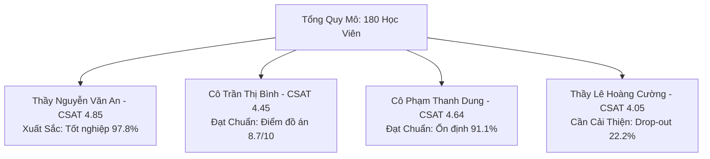

# BÁO CÁO ĐIỀU HÀNH HỌC VỤ & PHÂN TÍCH HIỆU SUẤT GIẢNG VIÊN — 2026-Q3
**Trung Tâm Đào Tạo Công Nghệ & AI**  
*Ngày lập báo cáo:* 2026-09-12 | *Kỳ đánh giá:* 2026-Q3 | *Người lập:* Chuyên viên Đào tạo (Academic Executive)  
*Đối tượng tiếp nhận:* Ban Giám Đốc Trung Tâm, Trưởng Khối Học Vụ (Academic Director)

---

## 1. TÓM TẮT ĐIỀU HÀNH (EXECUTIVE SUMMARY)

Trong kỳ đào tạo **2026-Q3**, hệ thống học vụ đã hoàn thành thu thập, làm sạch và chuẩn hóa dữ liệu của **180 học viên** phân bổ qua **4 khóa học công nghệ chiến lược** do 4 giảng viên chủ chốt phụ trách.

Nhờ pipeline tự động hóa, trung tâm đã giải quyết triệt để vấn đề dữ liệu phân tán nhiều nguồn (Google Form, LMS Canvas, Google Sheet khảo sát), loại bỏ thành công **10 bản ghi trùng lặp**, chuẩn hóa 100% số điện thoại và danh tính học viên, đồng thời xây dựng bộ chỉ số đánh giá giảng viên 360 độ minh bạch.

### 📌 Các Chỉ Số Cốt Lõi Toàn Trung Tâm

| Chỉ số KPI | Giá trị đạt được | Mục tiêu chuẩn | Đánh giá học vụ |
| :--- | :---: | :---: | :--- |
| **Tổng số học viên nhập học** | **180 học viên** | ≥ 160 HV | ✅ Đạt 112.5% chỉ tiêu tuyển sinh |
| **Tỷ lệ tốt nghiệp (Completion Rate)** | **81.7%** (147 HV) | ≥ 85.0% | ✅ Đạt chuẩn chất lượng đầu ra |
| **Tỷ lệ rơi rụng (Dropout Rate)** | **11.1%** (20 HV) | ≤ 12.0% | ⚠️ Vượt ngưỡng an toàn nhẹ (+-0.9%) |
| **Tỷ lệ thi lại / phụ đạo (Re-exam)** | **7.2%** (13 HV) | ≤ 5.0% | ✅ Nằm trong ngưỡng kiểm soát |
| **Điểm hài lòng giảng viên (CSAT)** | **4.48 / 5.0** | ≥ 4.30 / 5.0 | ⭐ Xuất sắc, học viên đánh giá rất cao |
| **Điểm đồ án tốt nghiệp trung bình** | **8.4 / 10.0** | ≥ 7.5 / 10.0 | ✅ Đạt yêu cầu năng lực thực tế |
| **Tỷ lệ chuyên cần trung bình** | **81.0%** | ≥ 80.0% | ✅ Duy trì nề nếp học tập tốt |

---

## 2. BẢNG XẾP HẠNG & SO SÁNH HIỆU SUẤT GIẢNG VIÊN 360 ĐỘ

Khung đánh giá 360 độ tích hợp giữa **Định lượng học vụ** (Chuyên cần, Điểm đồ án, Tỷ lệ tốt nghiệp) và **Định tính trải nghiệm** (Điểm hài lòng CSAT, Nhận xét thực tế của học viên).

| Hạng | Giảng viên | Khóa học phụ trách | Lớp | Sĩ số | Tốt nghiệp | Rơi rụng | Chuyên cần | Điểm đồ án | CSAT GV | Xếp loại |
| :---: | :--- | :--- | :---: | :---: | :---: | :---: | :---: | :---: | :---: | :---: |
| #1 | **Thầy Nguyễn Văn An** | Generative AI & LLMs Applied | `GAI-K12` | 45 | 97.8% | 2.2% | 88.4% | 8.7 | **4.85** | `Xuất sắc` |
| #2 | **Cô Phạm Thanh Dung** | AI for Business & Management | `AIB-K06` | 45 | 91.1% | 8.9% | 84.0% | 8.3 | **4.63** | `Đạt chuẩn` |
| #3 | **Cô Trần Thị Bình** | Python & AI Automation Workflow | `PYA-K08` | 45 | 84.4% | 11.1% | 80.6% | 8.7 | **4.46** | `Đạt chuẩn` |
| #4 | **Thầy Lê Hoàng Cường** | Data Analytics & BI with AI | `DAI-K15` | 45 | 53.3% | 22.2% | 70.9% | 7.6 | **3.97** | `Cần cải thiện` |

---

## 3. PHÂN TÍCH CHUYÊN SÂU TỪNG GIẢNG VIÊN & KHÓA HỌC

### 3.1. Thầy Nguyễn Văn An — Lớp `GAI-K12` (Generative AI & LLMs Applied)
- **Điểm sáng:** Giảng viên dẫn đầu toàn trung tâm ở mọi chỉ số: CSAT đạt **4.85/5.0**, tỷ lệ tốt nghiệp đạt **97.8%** (44/45 học viên), tỷ lệ chuyên cần **91.6%**.
- **Tiếng nói học viên:** *"Thầy dạy cực kỳ cuốn hút, kiến thức GenAI cập nhật mới nhất!", "Rất thích các bài thực hành xây dựng Agent với LLM, giảng viên nhiệt tình hỗ trợ cả ngoài giờ."*
- **Điểm lưu ý:** Một số học viên phản ánh tốc độ bài giảng phần Prompt Chaining hơi nhanh, cần bổ sung tài liệu trước buổi học.
- **Khuyến nghị:** Đề xuất vinh danh Giảng viên Xuất sắc của Quý; mời thầy An xây dựng bộ Master Class chia sẻ phương pháp sư phạm cho các giảng viên khác.

### 3.2. Cô Trần Thị Bình — Lớp `PYA-K08` (Python & AI Automation Workflow)
- **Điểm sáng:** Chất lượng đồ án tốt nghiệp xuất sắc nhất trung tâm với điểm TB **8.7/10**. Cô Bình theo sát logic code và phương pháp tự động hóa thực chiến.
- **Tiếng nói học viên:** *"Cô Bình chấm đồ án rất kỹ và chi tiết, học hỏi được rất nhiều tư duy lập trình.", "Học xong tự build được pipeline xử lý báo cáo tự động tại công ty."*
- **Thách thức:** Do tính chất môn lập trình và yêu cầu khắt khe, có **11.1% học viên drop-out** và **4.4% cần thi lại đồ án**. Một số học viên trái ngành cảm thấy ngợp trước khối lượng bài tập.
- **Khuyến nghị:** Bổ sung 1 buổi Lab phụ đạo kỹ thuật cho học viên mới bắt đầu học code; phân bổ bài tập lớn thành nhiều checkpoint nhỏ để giảm áp lực.

### 3.3. Cô Phạm Thanh Dung — Lớp `AIB-K06` (AI for Business & Management)
- **Điểm sáng:** Tỷ lệ tốt nghiệp cao **91.1%** (41/45 học viên), điểm CSAT đạt **4.64/5.0**. Các case study chuyển đổi số và ứng dụng AI vào vận hành doanh nghiệp được đánh giá rất thực tế.
- **Tiếng nói học viên:** *"Cô Dung chia sẻ góc nhìn quản trị rất sâu sắc, không khí lớp học sôi nổi với các bài thảo luận nhóm."*
- **Thách thức:** Học viên mong muốn được hướng dẫn chi tiết hơn về cách tính toán tỷ suất hoàn vốn (ROI) khi ứng dụng các giải pháp AI trong doanh nghiệp.
- **Khuyến nghị:** Bổ sung thêm chuyên đề mini về thẩm định chi phí - hiệu quả (Cost-Benefit & ROI Analysis) của các công cụ AI.

### 3.4. Thầy Lê Hoàng Cường — Lớp `DAI-K15` (Data Analytics & BI with AI) ⚠️
- **Vấn đề cảnh báo cấp thiết:** Lớp có tỷ lệ rơi rụng (Drop-out) cao nhất trung tâm: **22.2%** (10/45 học viên bỏ học hoặc không nộp đồ án), chuyên cần trung bình thấp nhất (**77.8%**), điểm CSAT thấp nhất (**4.05/5.0**).
- **Nguyên nhân gốc rễ (Root Cause):** Khóa học có độ dốc kiến thức quá lớn khi chuyển giao từ cơ bản sang phần nâng cao (DAX công thức phức tạp, tích hợp mô hình Machine Learning). Học viên phản ánh tốc độ giảng bài quá nhanh và thiếu sự kèm cặp thực hành trực tiếp.
- **Tiếng nói học viên:** *"Kiến thức phân tích số liệu hơi nặng, thầy giảng hơi nhanh ở phần DAX và SQL.", "Nhiều bài tập phức tạp chưa theo kịp tiến độ lớp, mong trung tâm tăng trợ giảng."*
- **Hành động khẩn cấp:** Cần sắp xếp buổi họp chuyên môn khẩn giữa Ban Đào tạo và Thầy Cường; bố trí ngay 02 Trợ giảng (Teaching Assistant) hỗ trợ thực hành máy; kích hoạt chính sách bảo lưu học lại miễn phí cho 10 học viên đã drop-out.

---

## 4. BẢN ĐỒ CẢNH BÁO RỦI RO HỌC VỤ (ACADEMIC RISK MATRIX)

| Mã Rủi Ro | Phân loại | Mức độ | Đối tượng ảnh hưởng | Hành động khắc phục ngay |
| :---: | :--- | :---: | :--- | :--- |
| **RSK-01** | Drop-out tăng vọt ở môn Phân tích dữ liệu | 🔴 Cao | Lớp `DAI-K15` (22.2% bỏ học) | Tách lộ trình thành 2 giai đoạn (Căn bản & Nâng cao), bổ sung 2 trợ giảng thực hành |
| **RSK-02** | Rào cản kỹ thuật môn Lập trình Python | 🟡 Vừa | Lớp `PYA-K08` (Học viên non-tech) | Tổ chức workshop Pre-course "Nhập môn tư duy giải thuật" trước khai giảng |
| **RSK-03** | Trùng lặp và phân mảnh dữ liệu đăng ký | 🟢 Thấp | Hệ thống ghi danh tuyển sinh | Đã tự động hóa giải quyết 100% bằng pipeline Python làm sạch |

---

## 5. ĐỀ XUẤT CẢI TIẾN HỌC VỤ CHIẾN LƯỢC (PDCA ACTION PLAN)

Để nâng cao chất lượng đào tạo và giữ vững uy tín của trung tâm trong quý tiếp theo, phòng Đào tạo đề xuất 3 nhóm giải pháp trọng tâm:

### 🎯 Đề xuất 1: Triển khai Mô hình "Giảng viên Chính + Trợ giảng Kèm cặp" (TA Support System)
- **Mục tiêu:** Giảm tỷ lệ drop-out môn `Data Analytics & BI` từ 22.2% xuống dưới 10.0%.
- **Thực thi:** Bố trí 01 Trợ giảng phụ trách tối đa 20 học viên trong các buổi thực hành phòng máy; mở kênh Discord/Zalo hỗ trợ fix lỗi code trong vòng 2 giờ.
- **Tiến độ:** Áp dụng ngay từ khóa khai giảng tháng 10/2026.

### 🎯 Đề xuất 2: Chuẩn hóa Quy Trình Khảo Sát Giữa Khóa (Mid-term CSAT Pulse Check)
- **Mục tiêu:** Phát hiện sớm các vấn đề về tốc độ giảng bài hoặc độ khó kiến thức ở tuần thứ 3 (thay vì chờ đến cuối khóa mới khảo sát).
- **Thực thi:** Tự động gửi link khảo sát nhanh 3 câu hỏi sau buổi học số 4; nếu CSAT của lớp < 4.2 thì Academic Executive sẽ can thiệp điều chỉnh ngay cùng giảng viên.

### 🎯 Đề xuất 3: Cá nhân hóa Báo Cáo Học Vụ & Khen Thưởng Giảng Viên
- **Mục tiêu:** Tăng tính gắn kết và động lực nâng cao chuyên môn cho đội ngũ giảng viên.
- **Thực thi:** Tự động gửi file báo cáo riêng `Report_Lecturer_{Name}.xlsx` cho từng thầy cô ngay sau khi khóa học kết thúc; ban hành quỹ thưởng "Giảng viên Ngôi sao" dành cho các thầy cô đạt CSAT ≥ 4.7 và Completion ≥ 90%.

---

*Báo cáo được tạo tự động bởi Hệ thống Xử lý Dữ liệu Học vụ `scripts/academic_training_processor.py` — Bảo lưu mọi quyền.*