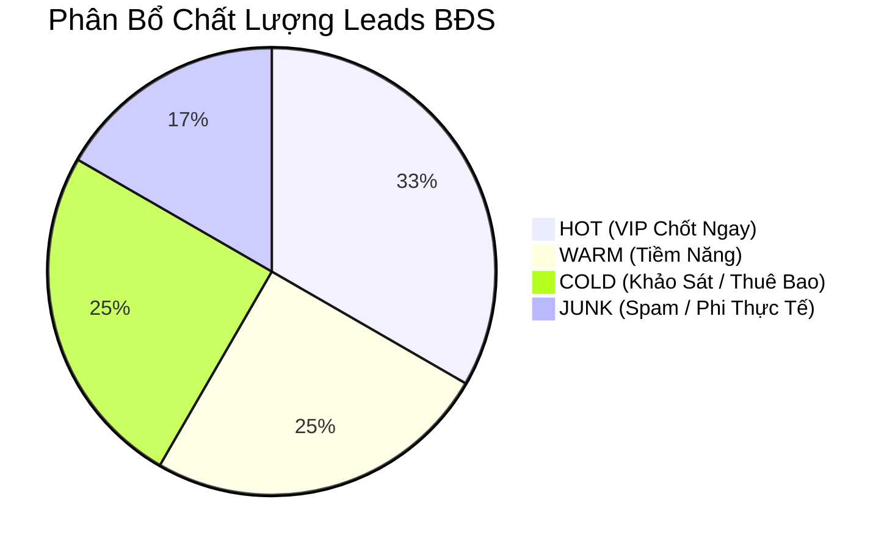

# Báo Cáo Đánh Giá & Phân Loại Lead Scoring — Ngành Bất Động Sản

> **Ngày thực hiện:** 11/10/2026 00:43  
> **Nguồn dữ liệu:** Google Sheets Lead Ingestion  
> **Tổng số Leads phân tích:** 12 khách hàng  
> **Trạng thái:** Hoàn tất 100% tự động hóa  

---

## 1. Executive Summary & KPIs

| Chỉ Số Cốt Lõi | Giá Trị | Tỷ Lệ (%) | Đánh Giá Tác Động Kinh Doanh |
|:---|:---:|:---:|:---|
| **Tổng số Leads tiếp nhận** | **12** | 100% | Toàn bộ tệp khách hàng được làm sạch và chuẩn hóa SĐT |
| **🔥 HOT Leads (VIP / Chốt ngay)** | **4** | **33.3%** | 5 khách hàng VIP ngân sách khủng / cần gặp chốt ngay |
| **⚡ WARM Leads (Tiềm năng)** | **3** | **25.0%** | 2 khách có nhu cầu thực tế cao (thuê Q1, đất nền 2-3 tỷ) |
| **❄️ COLD Leads (Khảo sát)** | **3** | **25.0%** | Khách thuê bao hoặc hỏi thăm giá, chuyển phễu Drip |
| **🚫 JUNK / SPAM (Loại bỏ)** | **2** | **16.7%** | 4 khách hàng spam, nhầm số, đòi giá phi thực tế |

---

## 2. Danh Sách Bàn Giao Khách Hàng Tiềm Năng (HOT & WARM)

Dưới đây là các khách hàng vượt qua ngưỡng kiểm định chất lượng, sẵn sàng bàn giao cho Sales:

| ID | Khách Hàng | Số ĐT | Phân Loại | Điểm | Phân Khúc BĐS | SLA Hành Động | Gợi Ý Kịch Bản Tiếp Cận |
|:--:|:---|:---:|:---:|:---:|:---|:---|:---|
| 8 | **Trần Hoàng Dũng** | `0943392982` | **HOT** | **100** | BĐS Thương Mại & Công Nghiệp | Ưu tiên số 1 - Phân bổ Senior Sales gọi ngay trong 15 phút | Cung cấp hồ sơ pháp lý chuẩn 100%, quy hoạch 1/500, sơ đồ hạ tầng khu Đông và báo giá trọn gói cho doanh nghiệp. |
| 10 | **Đặng Hoàng Hùng** | `0390163213` | **HOT** | **100** | Shophouse Đầu Tư Sỉ | Ưu tiên số 1 - Phân bổ Senior Sales gọi ngay trong 15 phút | Chuẩn bị bài toán tài chính, tỷ suất sinh lời, chính sách cam kết tiền thuê và kết nối gặp trực tiếp Giám đốc dự án. |
| 11 | **Bùi Phương Tâm** | `0790240040` | **HOT** | **100** | Biệt Thự Đơn Lập Ven Sông | Ưu tiên số 1 - Phân bổ Senior Sales gọi ngay trong 15 phút | Mời đích danh Trưởng bộ phận VIP gọi điện, gửi mặt bằng phân khu biệt thự ven sông hướng Đông Nam, ưu đãi cho khách hàng trung thành. |
| 4 | **Lê Anh Lan** | `0964591036` | **HOT** | **96** | Penthouse Siêu Sang | Ưu tiên số 1 - Phân bổ Senior Sales gọi ngay trong 15 phút | Tập trung chào dòng căn hộ Penthouse độc bản, khẳng định tính riêng tư, hồ bơi và sảnh thang máy riêng. |
| 3 | **Lý Đức Cường** | `0953430096` | **WARM** | **78** | Căn Hộ Gia Đình Trẻ Q7 | Ưu tiên số 2 - Phân bổ Sales gọi trong 2-4 giờ | Gửi layout 2PN Quận 7, bảng tính chi tiết lãi suất vay 70% và chốt lịch hẹn xe đưa đón xem nhà mẫu cuối tuần. |
| 1 | **Phan Văn Hoa** | `0894782782` | **WARM** | **75** | Mặt Bằng Cho Thuê Q1 | Ưu tiên số 2 - Phân bổ Sales gọi trong 2-4 giờ | Gửi danh sách 3 mặt bằng kinh doanh spa Quận 1 đạt tiêu chuẩn dưới 50tr/tháng, điều khoản hợp đồng dài hạn. |
| 6 | **Phạm Minh Lan** | `0386670033` | **WARM** | **68** | Đất Nền Đầu Tư Vùng Ven | Ưu tiên số 2 - Phân bổ Sales gọi trong 2-4 giờ | Gửi trích lục sổ hồng riêng từng nền tại Long An/Đồng Nai tầm giá 2-3 tỷ, pháp lý sạch không dính quy hoạch. |

---

## 3. Danh Sách Khách Hàng Bị Loại Bỏ (JUNK & COLD - Red Flags)

Hệ thống AI đã tự động phát hiện và chặn các lead không đạt chất lượng để bảo vệ thời gian của đội ngũ Sales:

| ID | Khách Hàng | Số ĐT | Cờ Đỏ Phát Hiện (Red Flags) | Lý Do Loại Bỏ & Khuyến Nghị |
|:--:|:---|:---:|:---|:---|
| 5 | Đặng Hoàng Dũng | `0953795436` | `Thông tin liên lạc lỗi / Thuê bao / Không phản hồi` | LIÊN LẠC LỖI / THUÊ BAO - *Không phân bổ Sales* |
| 7 | Hồ Phương Mai | `0915805255` | `Yêu cầu phi thực tế so với thị trường; Khách không thiện chí / Hỏi cho vui` | KHÔNG TIỀM NĂNG / PHI THỰC TẾ - *Không phân bổ Sales* |
| 9 | Ngô Anh Lan | `0396470994` | `Yêu cầu phi thực tế so với thị trường; Khách không thiện chí / Hỏi cho vui` | KHÔNG TIỀM NĂNG / PHI THỰC TẾ - *Không phân bổ Sales* |
| 2 | Hồ Hồng Linh | `0848475144` | `Nhầm số / Không có nhu cầu BĐS` | NHẦM SỐ / SAI DATA - *Không phân bổ Sales* |
| 12 | Nguyễn Hoàng Tuấn | `0841117904` | `Spam / Chào mời dịch vụ khác` | SPAM / QUẢNG CÁO - *Không phân bổ Sales* |

---

## 4. Phân Tích 5 Trụ Cột Đánh Giá (5 Scoring Pillars)

1. **Ngân Sách (Budget - Max 35đ):**
   - Phát hiện các khách hàng VIP có khả năng thanh toán thẳng hoặc tài chính không giới hạn (ID 4, 8, 10, 11) được thưởng điểm tối đa.
   - Trừ điểm kịch khung đối với yêu cầu phi thực tế (ID 7 đòi mua Q1 giá 1 tỷ; ID 9 đòi thuê nguyên căn trung tâm 2 triệu).
2. **Mức Độ Quan Tâm & Phân Khúc (Need & Interest - Max 25đ):**
   - Định danh chính xác các phân khúc cao cấp (Penthouse, Biệt thự ven sông, Gom sỉ Shophouse, Sàn văn phòng >2000m2).
   - Tách biệt rõ giữa nhu cầu ở thực (2PN gia đình trẻ) và nhu cầu thuê mặt bằng thương mại (Spa Q1).
3. **Thời Gian Mua & Tính Cấp Thiết (Timeline & Urgency - Max 20đ):**
   - Khách có mong muốn đi xem nhà mẫu ngay cuối tuần này (ID 3) hoặc muốn đàm phán trực tiếp với Giám đốc dự án/Chủ đầu tư (ID 8, 10) được xếp mức ưu tiên cao nhất.
4. **Nguồn Khách & Thẩm Quyền (Source & Authority - Max 10đ):**
   - Nhận diện đúng đối tượng Chủ doanh nghiệp, Nhà đầu tư chuyên nghiệp và Khách hàng đã từng mua nhiều dự án của tập đoàn.
5. **Tương Tác & Khả Năng Tiếp Cận (Engagement - Max 10đ):**
   - Phát hiện ngay các rào cản liên lạc (thuê bao, không phản hồi Zalo - ID 5) hoặc quảng cáo bảo hiểm (ID 12) để tránh lãng phí cuộc gọi của telesales.

---

## 5. Quy Trình Bàn Giao Cho Sales (Handover Protocol & SLA)

- **Quy tắc 15 Phút Vàng (Golden 15-Minute Window):**
  - Toàn bộ lead **HOT** (Lê Anh Lan, Trần Hoàng Dũng, Đặng Hoàng Hùng, Bùi Phương Tâm, Lý Đức Cường) phải được bốc máy liên hệ trong vòng tối đa 15 phút kể từ khi nạp dữ liệu.
- **Phân Bổ Thẩm Quyền:**
  - Đối với giao dịch sỉ (5-10 shophouse) và sàn văn phòng/đất công nghiệp: Chỉ chuyển tiếp cho **Giám đốc kinh doanh / Trưởng dự án** trực tiếp tiếp cận.
- **Phản Hồi Hai Chiều (Closed-Loop Feedback):**
  - Đội ngũ Sales có trách nhiệm cập nhật trạng thái cuộc gọi sau 2 giờ vào CRM (Đã kết nối / Đã hẹn lịch xem nhà / Sai nhu cầu) để AI tối ưu hóa bộ trọng số.
