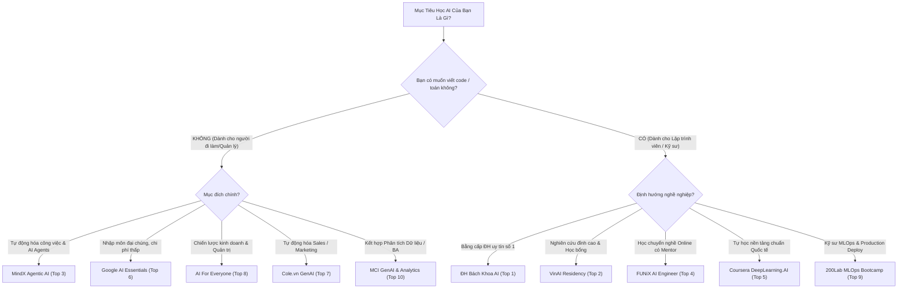

# BÁO CÁO NGHIÊN CỨU & XẾP HẠNG: TOP 10 KHÓA HỌC TRÍ TUỆ NHÂN TẠO (AI) TỐT NHẤT TẠI VIỆT NAM

**Người thực hiện:** Chuyên viên Phân tích & Nghiên cứu Thị trường Giáo dục Công nghệ (EdTech Research Analyst)
**Tập dữ liệu gốc:** [top_10_khoa_hoc_ai.xlsx](<file:///Users/mac/Documents/Haiyentn2295/Agentic%20AI/my-workspace/outputs/reports/top_10_khoa_hoc_ai.xlsx>) (và bản sao [sample-data/top_10_khoa_hoc_ai.xlsx](<file:///Users/mac/Documents/Haiyentn2295/Agentic%20AI/my-workspace/sample-data/top_10_khoa_hoc_ai.xlsx>))
**Thời gian hoàn thành:** 06/09/2026
**Phương pháp nghiên cứu:** Khảo sát đa chiều kết hợp đánh giá thực tế học viên, uy tín đơn vị đào tạo, tính thực chiến của chương trình và sự công nhận của thị trường tuyển dụng.

---

## 1. TỔNG QUAN THỊ TRƯỜNG ĐÀO TẠO AI TẠI VIỆT NAM (EXECUTIVE SUMMARY)

Bước sang năm 2026, làn sóng Trí tuệ Nhân tạo (AI) tại Việt Nam đã chuyển dịch mạnh mẽ từ giai đoạn **"tò mò / trải nghiệm công cụ đơn lẻ"** sang giai đoạn **"tự động hóa hệ thống & ứng dụng thực chiến trong hoạt động cốt lõi"**.

Bức tranh đào tạo AI tại Việt Nam hiện nay phân hóa thành 2 trường phái rất rõ nét:

1. **Trường phái AI Ứng Dụng Thực Chiến (Applied AI for Non-tech / Business):** Tập trung vào Kỹ thuật Prompt chuyên sâu, Tự động hóa quy trình với AI Agents (Agentic AI), tích hợp GenAI vào Marketing, Sales, Vận hành và Phân tích Dữ liệu. Nhóm này không yêu cầu kỹ năng lập trình phức tạp và có thời gian hoàn vốn đầu tư (ROI) rất nhanh.
2. **Trường phái AI Kỹ Thuật Chuyên Sâu (Technical AI & Engineering):** Dành cho kỹ sư phần mềm, cử nhân CNTT và nhà nghiên cứu muốn làm chủ thuật toán Machine Learning, Deep Learning, Computer Vision, Xử lý ngôn ngữ tự nhiên (NLP) và triển khai mô hình lên môi trường Production (MLOps).

### Các Chỉ Số Thị Trường Nổi Bật:

* **Điểm uy tín & chất lượng trung bình:** **4.76 / 5.0** (Top 10 khóa học đều có đánh giá xuất sắc từ cộng đồng).
* **Học phí bình quân nhóm Kỹ thuật:** **10,020,000 VND** (Dao động từ 3,600,000 VND đến 18,500,000 VND, kèm chương trình học bổng 100% của VinAI).
* **Học phí bình quân nhóm Ứng dụng:** **4,460,000 VND** (Dao động từ 1,000,000 VND đến 7,500,000 VND, rất dễ tiếp cận cho người đi làm).
* **Hình thức đào tạo:** 70% khóa học hỗ trợ Online / Hybrid linh hoạt, tạo điều kiện thuận lợi cho người vừa đi làm vừa học.

---

## 2. BẢNG XẾP HẠNG CHI TIẾT TOP 10 KHÓA HỌC AI HÀNG ĐẦU VIỆT NAM

|  Xếp Hạng  | Tên Khóa Học                                                                 | Đơn Vị Đào Tạo                      |     Phân Loại AI     |      Học Phí Ước Tính      |      Thời Lượng & Hình Thức      |  Điểm Uy Tín  | Chứng Chỉ Cấp                                 |
| :----------: | :------------------------------------------------------------------------------ | :---------------------------------------- | :---------------------: | :------------------------------: | :-----------------------------------: | :--------------: | :----------------------------------------------- |
| **1** | **Khóa Đào Tạo Kỹ Sư Trí Tuệ Nhân Tạo & Học Máy Thực Hành** | Đại học Bách Khoa (Hà Nội / TP.HCM) | Kỹ thuật chuyên sâu |          18,500,000 ₫          |    5 - 6 tháng (Offline / Hybrid)    | **4.9 ⭐** | Chứng chỉ Chuyên gia AI Đại học Bách Khoa |
| **2** | **Chương Trình AI Residency & Advanced Machine Learning**              | VinAI Research (Tập đoàn Vingroup)     | Kỹ thuật chuyên sâu | **Học bổng 100%** (0 ₫) | 12 - 24 tháng (Full-time Onsite HN) | **4.9 ⭐** | Chứng nhận VinAI Residency quốc tế           |
| **3** | **Khóa Học Agentic AI & GenAI for Working Professionals**               | MindX Technology School                   | Ứng dụng thực chiến |           7,500,000 ₫           |  6 - 8 tuần (Online Live / Hybrid)  | **4.8 ⭐** | MindX Professional Agentic AI Specialist         |
| **4** | **Chương Trình Chuyên Gia Trí Tuệ Nhân Tạo (AI Engineer)**        | FUNiX (Tổ chức Giáo dục FPT)          | Kỹ thuật chuyên sâu |          16,000,000 ₫          |    6 tháng (Online 1-on-1 Mentor)    | **4.8 ⭐** | Chứng chỉ AI Engineer của FUNiX & FPT         |
| **5** | **Machine Learning & Deep Learning Specialization**                       | DeepLearning.AI / Coursera (Andrew Ng)    | Kỹ thuật chuyên sâu |     ~3,600,000 ₫ (3 tháng)     | 3 tháng (Online tự học linh hoạt) | **4.8 ⭐** | Chứng chỉ Stanford & DeepLearning.AI           |
| **6** | **Google AI Essentials (Chương Trình Bản Địa Hóa VN)**             | Google Career Certificates / NIC          | Ứng dụng thực chiến |           1,000,000 ₫           |  4 - 6 tuần (~15 giờ học Online)  | **4.7 ⭐** | Google Professional Certificate toàn cầu       |
| **7** | **Ứng Dụng Generative AI & Automation trong Doanh Nghiệp**             | Cole.vn (Vietnam AI Academy)              | Ứng dụng thực chiến |           5,500,000 ₫           |  4 tuần (Online Zoom thực chiến)  | **4.7 ⭐** | Certificate of Completion từ Cole.vn            |
| **8** | **AI For Everyone & GenAI for Business Leaders**                          | DeepLearning.AI / Coursera VN             | Ứng dụng thực chiến |           1,500,000 ₫           | 3 tuần (Online tự học linh hoạt) | **4.7 ⭐** | Verified Certificate từ DeepLearning.AI         |
| **9** | **Full-Stack Machine Learning & MLOps Bootcamp**                          | 200Lab Technology Education               | Kỹ thuật chuyên sâu |          12,000,000 ₫          | 4 tháng (Online Live + Code Review) | **4.6 ⭐** | Professional MLOps Specialist từ 200Lab         |
| **10** | **Generative AI & Data Analytics for Decision Making**                    | MCI Consulting & Academy                  | Ứng dụng thực chiến |           6,800,000 ₫           | 2 tháng (Offline & Online kết hợp) | **4.6 ⭐** | Chứng chỉ Chuyên viên Phân tích AI MCI     |

---

## 3. PHÂN TÍCH CHUYÊN SÂU TỪNG KHÓA HỌC

### Top 1 — Khóa Đào Tạo Kỹ Sư AI & Học Máy Thực Hành (Đại học Bách Khoa)

* **Thế mạnh:** Giáo trình học thuật bài bản, đội ngũ giảng viên là các Tiến sĩ, Phó Giáo sư đầu ngành về Khoa học Máy tính.
* **Nội dung:** Đi sâu từ giải thuật toán học (Đại số tuyến tính, Tối ưu hóa) đến mạng nơ-ron sâu (CNN, RNN, Transformers) trên nền tảng PyTorch.
* **Phù hợp nhất với:** Sinh viên năm cuối CNTT, lập trình viên muốn sở hữu văn bằng danh giá từ trường kỹ thuật số 1 Việt Nam.

### Top 2 — VinAI Residency Program (VinAI Research)

* **Thế mạnh:** Đỉnh cao nghiên cứu AI tại Đông Nam Á. Học viên được tài trợ 100% học bổng, nhận lương nghiên cứu và làm việc cùng các nhà khoa học AI hàng đầu thế giới.
* **Nội dung:** Nghiên cứu mô hình ngôn ngữ lớn (LLM), Multi-modal AI, hướng tới xuất bản bài báo tại NeurIPS, CVPR, ICML.
* **Phù hợp nhất với:** Các tài năng Toán - Tin kiệt xuất có định hướng làm tiến sĩ tại Mỹ/Châu Âu hoặc kỹ sư R&D nòng cốt.

### Top 3 — Agentic AI & GenAI for Working Professionals (MindX Technology School)

* **Thế mạnh:** Đi đầu xu hướng Agentic AI (AI Tự chủ) tại Việt Nam. Khóa học được thiết kế đo ni đóng giày cho người đi làm để tạo ra kết quả công việc ngay lập tức.
* **Nội dung:** Huấn luyện xây dựng hệ sinh thái Multi-Agent, tích hợp công cụ Antigravity, tự động hóa quy trình nghiệp vụ (Email, Báo cáo, Phân tích dữ liệu, Quản lý dự án).
* **Phù hợp nhất với:** Chuyên viên kinh doanh, marketing, nhân sự, tài chính, quản lý doanh nghiệp muốn tăng năng suất cá nhân gấp 5-10 lần.

### Top 4 — Chương Trình Chuyên Gia AI (FUNiX - FPT)

* **Thế mạnh:** Mô hình đào tạo trực tuyến linh hoạt với sự đồng hành 1-on-1 của mạng lưới Mentor là các kỹ sư cao cấp tại FPT Software.
* **Nội dung:** Lộ trình từ cơ bản đến xây dựng mô hình AI hoàn chỉnh, cam kết kết nối việc làm sau khi tốt nghiệp.
* **Phù hợp nhất với:** Người muốn chuyển nghề sang AI nhưng cần lộ trình linh hoạt về thời gian.

### Top 5 — Machine Learning Specialization (DeepLearning.AI / Coursera)

* **Thế mạnh:** Giáo trình kinh điển toàn cầu do GS. Andrew Ng trực tiếp giảng dạy; đã có phụ đề tiếng Việt chuẩn hóa.
* **Nội dung:** Nền tảng cốt lõi không thể thiếu của mọi kỹ sư AI trên thế giới; hệ thống bài tập thực hành chấm điểm tự động xuất sắc.
* **Phù hợp nhất với:** Người có kỷ luật tự học cao, muốn học lý thuyết chuẩn quốc tế với chi phí tối ưu.

### Top 6 — Google AI Essentials (Google & NIC Vietnam)

* **Thế mạnh:** Chương trình chính thức của Google được Trung tâm Đổi mới sáng tạo Quốc gia (NIC) hỗ trợ đưa về Việt Nam, tính ứng dụng đại chúng rất cao.
* **Nội dung:** Nhập môn AI từ con số 0, kỹ năng viết Prompt, làm chủ các công cụ AI của Google và đối tác để giải quyết công việc thường nhật.
* **Phù hợp nhất với:** Mọi đối tượng bắt đầu tìm hiểu AI mà không cần biết lập trình.

### Top 7 — Ứng Dụng Generative AI & Automation (Cole.vn)

* **Thế mạnh:** Tích hợp sâu giữa GenAI và các công cụ no-code automation (Make, Zapier, Google Workspace).
* **Nội dung:** Xây dựng hệ thống tiếp thị tự động, tạo phễu chăm sóc khách hàng bằng chatbot AI thông minh.
* **Phù hợp nhất với:** Đội ngũ Sales, Marketing và các chủ doanh nghiệp vừa và nhỏ (SMEs).

### Top 8 — AI For Everyone (DeepLearning.AI / Coursera)

* **Thế mạnh:** Góc nhìn quản trị chiến lược không kỹ thuật do Andrew Ng thiết kế riêng cho tầng lớp lãnh đạo.
* **Nội dung:** Đánh giá tính khả thi của dự án AI, dự toán chi phí & đo lường ROI khi áp dụng AI vào công ty.
* **Phù hợp nhất với:** CEO, Giám đốc chức năng, Trưởng bộ phận, Product Owner.

### Top 9 — Full-Stack Machine Learning & MLOps Bootcamp (200Lab)

* **Thế mạnh:** Tập trung vào kỹ năng "đưa AI vào đời sống" — MLOps (Machine Learning Operations).
* **Nội dung:** Docker, Kubernetes, CI/CD cho AI, quản lý vòng đời mô hình (MLflow, DVC), giám sát hiệu năng mô hình trong môi trường tải lớn.
* **Phù hợp nhất với:** Kỹ sư Backend, DevOps muốn chuyển đổi thành MLOps Engineer (vị trí có mức lương thuộc top thị trường).

### Top 10 — Generative AI & Data Analytics for Decision Making (MCI)

* **Thế mạnh:** Kết hợp sức mạnh của Phân tích Dữ liệu truyền thống (SQL, PowerBI) với GenAI.
* **Nội dung:** Ứng dụng AI để viết câu truy vấn phức tạp, giải thích trực quan hóa dữ liệu và dự báo kinh doanh.
* **Phù hợp nhất với:** Chuyên viên phân tích nghiệp vụ (BA), phân tích dữ liệu (DA), kế toán - tài chính.

---

## 4. MA TRẬN SO SÁNH & HƯỚNG DẪN LỰA /CHỌN (DECISION MATRIX)

---

## 5. KẾT LUẬN & ĐỀ XUẤT HÀNH ĐỘNG

1. **Đối với người đi làm phi kỹ thuật:** Không nên bắt đầu bằng các khóa học toán hay code phức tạp. Hãy bắt đầu từ **MindX Agentic AI** hoặc **Google AI Essentials** để nhanh chóng ứng dụng AI vào việc giải quyết công việc hàng ngày ngay trong tuần đầu tiên.
2. **Đối với lập trình viên / sinh viên kỹ thuật:** Cần trang bị vững nền tảng Machine Learning lý thuyết trước (khóa **DeepLearning.AI** của Andrew Ng), sau đó nâng cấp bằng khóa học chuyên sâu có đồ án thực tế như **ĐH Bách Khoa** hoặc kỹ năng triển khai hệ thống tại **200Lab MLOps**.
